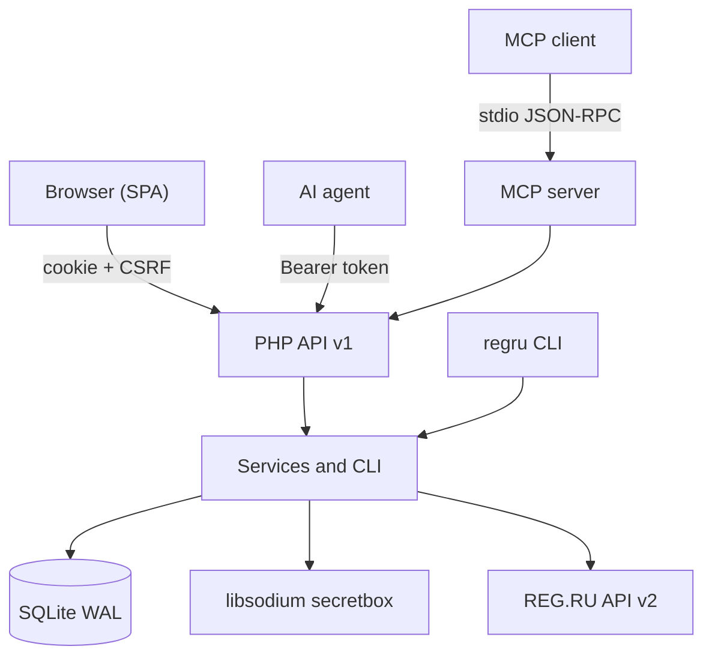

# REG.RU Control

<!-- md-i18n:switcher -->
**In anderen Sprachen:** [English](README.md) · Deutsch · [中文](README.zh.md) · [हिन्दी](README.hi.md) · [Español](README.es.md) · [Русский](README.ru.md)

**Eine selbst gehostete Verwaltungsoberfläche für REG.RU-Domains, DNS und Hosting: eine Weboberfläche für Menschen, eine JSON-API und ein MCP-Server für KI-Agenten.**

[](https://github.com/paulmann/regru-control/actions/workflows/ci.yml)
[](https://github.com/paulmann/regru-control/releases)
[](LICENSE)
[](https://www.php.net/)
[](backend/tests/run.php)
[](docs/MCP.md)
[](frontend/assets/js/locales)


[**Schnellstart**](#schnellstart) · [**Dokumentation**](#dokumentation) · [**API**](#api) · [**MCP**](#mcp-für-ki-agenten) · [**Wiki**](https://github.com/paulmann/regru-control/wiki) · [**AGENTS.md**](AGENTS.md) · [**Changelog**](CHANGELOG.md) · [**Issues**](https://github.com/paulmann/regru-control/issues) · [**Security**](SECURITY.md)

Der Registrar REG.RU stellt 116 dokumentierte Befehle der API v2 bereit, verteilt über Dutzende Methoden, mit uneinheitlichen Fehlerformaten und ohne einen einzigen Ort, an dem Domains, DNS-Zonen, Hosting und Guthaben gleichzeitig sichtbar sind. Selbst geschriebene Skripte lösen eine Aufgabe und brechen dann beim ersten fachlichen Fehler. Dieses Projekt bündelt die Arbeit am Konto in einer Oberfläche: Inventar, Verlängerung, DNS, Zugriff, Abrechnung und ein Änderungsprotokoll. Was es von Hüllen um einzelne Befehle unterscheidet, ist, dass das Backend für sich steht: alles, was die Oberfläche tut, ist über die HTTP-API verfügbar, und die API ist ohne zusätzlichen Code über den MCP-Server verfügbar.

> **Stand der Dokumentation.** Die Zahlen in dieser README wurden am veröffentlichten Stand vom 23.10.2026 (Version 1.0.0) gemessen. Ausführliche Anleitungen stehen im [Wiki](https://github.com/paulmann/regru-control/wiki) und in [`docs/`](docs/); das Protokoll für Agenten steht in [`AGENTS.md`](AGENTS.md).

Dieses Projekt ist nicht mit REG.RU verbunden. „REG.RU“ ist eine Marke ihres jeweiligen Inhabers.

---

## Inhalt

- [Was es ist und warum](#was-es-ist-und-warum)
- [Anwendungsfälle](#anwendungsfälle)
- [Funktionen](#funktionen)
- [In Zahlen](#in-zahlen)
- [Wie es funktioniert](#wie-es-funktioniert)
- [Installation](#installation)
- [Schnellstart](#schnellstart)
- [Konfiguration](#konfiguration)
- [Kommandozeile](#kommandozeile)
- [Zuverlässigkeit und Grenzen](#zuverlässigkeit-und-grenzen)
- [Sicherheit](#sicherheit)
- [Anforderungen und Kompatibilität](#anforderungen-und-kompatibilität)
- [Dokumentation](#dokumentation)
- [Entwicklung](#entwicklung)
- [FAQ](#faq)
- [Mitwirken](#mitwirken)
- [Dem Projekt helfen — mit Fakten, nicht mit Betriebsamkeit](#dem-projekt-helfen--mit-fakten-nicht-mit-betriebsamkeit)
- [Lizenz](#lizenz)

---

## Was es ist und warum

Die Oberfläche deckt den gesamten Lebenszyklus eines REG.RU-Kontos ab:

- **Inventar.** Domains, Hosting, VPS, dedizierte Server, Lizenzen und Parking in einer Tabelle: Zahlungsdatum, verbleibende Tage, automatische Verlängerung, Name Server, Status.
- **Domains.** Verlängerung, automatische Verlängerung, NS-Wechsel, Entfernen aus der Delegation, Eigentumsnachweis, DNSSEC.
- **DNS.** A, AAAA, CNAME, MX, TXT, NS, SRV, CAA, SOA/TTL — atomare Änderungen an Einträgen und Aktualisierung aus der Registry.
- **Hosting.** IP-Adressen, Panel-Verknüpfungen, Logins; Passwörter, wo REG.RU sie herausgibt, sonst von Hand in den verschlüsselten Speicher eingetragen.
- **Zugriff.** Ein Passwortspeicher auf libsodium-Basis mit einem Audit-Eintrag für jede Offenlegung.
- **Abrechnung.** Guthaben, offene Rechnungen, Verlauf für einen Zeitraum.
- **Betrieb.** cron-Synchronisierung, SQLite-Sicherungen, ein Aktionsprotokoll, `doctor`.

Zentrale Entscheidungen:

| Entscheidung | Warum |
|---|---|
| Keine Composer- und Node-Abhängigkeiten | Installation mit einem `git clone` plus PHP; Aktualisierungen brechen nicht an transitiven Paketen |
| SQLite statt eines eigenen DBMS | die Oberfläche ist ein einzelner Knoten; WAL und `VACUUM INTO` liefern konsistente Sicherungen ohne Administration |
| Geheimnisse nur verschlüsselt | der `APP_KEY` bleibt außerhalb von Datenbank und git; das Offenlegen eines Passworts ist eine eigene Berechtigung und ein Protokolleintrag |
| Die API als primäre Quelle | jede Funktion der Oberfläche ist über HTTP verfügbar; der MCP-Server nutzt dieselbe API |
| Eine Codebasis für Oberfläche und Agenten | kein Auseinanderlaufen zwischen dem, was ein Mensch sieht, und dem, was ein Agent tut |

## Anwendungsfälle

| Aufgabe | Was zu verwenden ist | Ergebnis |
|---|---|---|
| Sehen, was in den nächsten 60 Tagen abläuft | „Übersicht“ oder `GET /api/v1/domains?expiring_in=60` | eine Liste von Domains und Hosting mit den verbleibenden Tagen |
| Eine Domain verlängern und die automatische Verlängerung einschalten | die Oberfläche „Domains“ oder `POST /api/v1/domains/{name}/renew` | ein Aufruf bei REG.RU und ein Protokolleintrag |
| Einen A-Eintrag für einen Dienst hinzufügen | „DNS“ oder `POST /api/v1/domains/{name}/dns/records` | ein Eintrag in der Zone, mit Typprüfung |
| Einem Agenten Lesezugriff auf das Inventar ohne Schreibzugriff geben | ein Token mit dem Bereich `read` plus `GET /api/v1/inventory` | kompaktes JSON ohne Geheimnisse |
| Einen Agenten direkt an die Oberfläche anbinden | der MCP-Server `php mcp/server.php` | 13 Werkzeuge, standardmäßig nur lesend |
| Feststellen, wer ein Passwort offengelegt hat und wann | „Aktivitätsprotokoll“ oder `GET /api/v1/audit` | Akteur, IP, Zeit, `request_id` |
| Den Zustand nach einem Ausfall wiederherstellen | `regru backup` + `var/backups/*.sqlite` | ein Datenbankabbild mit Rotation über 14 Kopien |

## Funktionen

| Funktion | Details |
|---|---|
| REG.RU-Inventar | 116 Befehle der API v2 im Katalog; typisierte Hüllen für Domains, DNS, Dienste, Abrechnung |
| Synchronisierung | die Stufen `services` → `details` → `dns`; eine scheiternde Stufe bricht die anderen nicht ab, Status `partial` |
| Rohkonsole | ein beliebiger Aufruf eines beliebigen Befehls unter dem Bereich `regru:raw` |
| Sicherheit | Argon2id, CSRF, Ratenbegrenzung, strikte CSP, libsodium `secretbox`, Audit der Offenlegungen |
| API | Bearer-Token, Bereiche, OpenAPI, stabile Fehlercodes, `request_id` |
| MCP | stdio JSON-RPC 2.0; 13 Werkzeuge; Schreiboperationen nur hinter einem ausdrücklichen Schalter |
| Lokalisierung | `en` (Standard), `ru`, `zh`, `hi`, `de`, `es`; automatische Erkennung und ein Umschalter |
| Oberfläche | dunkles und helles Design, responsiv bis 390 px, kein CDN und keine externen Schriften |
| Betrieb | cron-Synchronisierung, Sicherungen, `doctor`, Aktionsprotokoll, Health-Check |

## In Zahlen

Gemessen am veröffentlichten Stand vom 23.10.2026 (Version 1.0.0):

| Bereich | Wert | Quelle der Messung |
|---|---:|---|
| PHP-Dateien / Zeilen | 128 / 11 368 | `backend/src`, `backend/bin`, `backend/config`, `public/`, `mcp/` |
| JavaScript-Dateien / Zeilen | 18 / 3 554 | `frontend/assets/js` |
| CSS | 552 Zeilen | `frontend/assets/css/app.css` |
| HTTP-Routen | 61 | `#[Route]`-Attribute in den Controllern |
| Automatisierte Tests | 38 | `php backend/tests/run.php` |
| Befehle der REG.RU API v2 im Katalog | 116 | `backend/config/regru-commands.json` |
| Sprachen der Oberfläche | 6 | `frontend/assets/js/locales` |
| Laufzeitabhängigkeiten | 0 | `composer.json` — nur Autoload |
| Migrationen | 2 | `backend/migrations` |

## Wie es funktioniert



| Komponente | Verantwortung |
|---|---|
| `Kernel` | HTTP-Kern, Router, Container, Konfiguration, Protokollierung, Lokalisierung |
| `Http` | Controller, Middleware, Presenter, OpenAPI |
| `RegRu` | der API2-Client, Verträge, typisierte Hüllen für Endpunkte |
| `Service` | Geschäftslogik: Synchronisierung, Domains, DNS, Zugriff, Abrechnung |
| `Repository` | SQLite, Migrationen, Abfragen |
| `Security` | Sitzungen, CSRF, Verschlüsselung, Token, Passwörter |
| `mcp/server.php` | die stdio-Brücke zwischen einem MCP-Client und der HTTP-API |
| `frontend` | eine SPA ohne Build-Schritt: ES-Module, i18n, Designs |

Fehlerpolitik: Transportfehler von REG.RU werden begrenzt oft wiederholt; fachliche Fehler werden nicht wiederholt und kommen mit einem Code zurück (`ACCESS_DENIED_FROM_IP`, `DOMAIN_IS_NOT_USE_REGRU_NSS`, `INSUFFICIENT_FUNDS` und andere). Jede Antwort trägt eine `request_id`, die zu einer Zeile im Protokoll passt.

## Installation

### Voraussetzungen

| Komponente | Anforderung |
|---|---|
| PHP | 8.5 (CLI + FPM), die Erweiterungen `curl`, `json`, `mbstring`, `openssl`, `pdo_sqlite`, `sodium` |
| Webserver | nginx (empfohlen) oder Apache mit Rewrite |
| TLS | für den Produktivbetrieb obligatorisch |
| Externer Zugriff | die Server-IP muss in der REG.RU API freigeschaltet sein |
| Composer, Node, MySQL | nicht erforderlich |

### Aus dem Quellcode

```bash
git clone https://github.com/paulmann/regru-control.git
cd regru-control

cp .env.example .env
php backend/bin/regru key:generate
php backend/bin/regru migrate
php backend/bin/regru user:create --login=admin
php backend/bin/regru serve --port=8099
```

`http://127.0.0.1:8099` öffnen.

### Auf einem Server

1. Den Auslieferungsbaum ohne `.git`, `var/` und die Tests bauen:

   ```bash
   php tools/build.php --target=../deploy
   ```

2. `deploy/` in das Site-Verzeichnis kopieren; das Web-Root ist das Verzeichnis mit `index.php`.
3. Auf dem Server `.env` anlegen und `php backend/bin/regru migrate` ausführen.
4. nginx nach dem Beispiel [`docs/deploy/nginx-regru-control.conf`](docs/deploy/nginx-regru-control.conf) konfigurieren: PHP nur für `index.php`, `deny all` für `backend/`, `frontend/`, `var/`, `docs/` und Dotfiles.
5. Den Zugriff über eine Netzwerkliste einschränken und HTTPS aktivieren.

Was der Installer anlegt: `.env` mit einem frischen `APP_KEY`, eine SQLite-Datenbank in `var/` und die Verzeichnisse `var/log`, `var/sessions`, `var/backups`. Außerhalb des Anwendungsverzeichnisses wird nichts geschrieben.

Aktualisierung: `git pull`, `php tools/lint.php`, `php backend/tests/run.php`, `php backend/bin/regru backup`, ausliefern, `php backend/bin/regru migrate`. Entfernung: cron stoppen, `.env` und `var/regru.sqlite` bei Bedarf behalten, das Anwendungsverzeichnis löschen.

## Schnellstart

```bash
# 1. Connect the REG.RU account (API password via stdin)
php backend/bin/regru account:set --login=<API_LOGIN> --password-stdin

# 2. Verify access and fill the inventory
php backend/bin/regru doctor --online
php backend/bin/regru sync --scope=all

# 3. Create a token for the agent (minimal privileges)
php backend/bin/regru token:create --name=agent --scopes=read --ttl-days=90
```

Das erste Ergebnis prüfen:

```bash
curl -s https://example.com/regru/api/v1/health
# {"data":{"status":"ok","version":"1.0.0","php":"8.5.x","db":{"ok":true},"regru_configured":true}}

curl -s -H "Authorization: Bearer $TOKEN" \
  https://example.com/regru/api/v1/inventory | jq '.data.counts'
```

## Konfiguration

Die wichtigsten `.env`-Variablen; die vollständige Liste steht in [`.env.example`](.env.example):

| Variable | Zweck | Standard |
|---|---|---|
| `APP_ENV` | Umgebung: `production`, `development`, `test` | `production` |
| `APP_DEBUG` | ausführliche Fehler | `0` |
| `APP_URL` | die öffentliche Adresse der Oberfläche | — |
| `APP_KEY` | der base64-Verschlüsselungsschlüssel (32 Byte) | erzeugt |
| `DB_PATH` | der Pfad zu SQLite | `var/regru.sqlite` |
| `SESSION_SECURE` | Cookies nur über HTTPS | `1` |
| `REGRU_TIMEOUT` | der Zeitlimit der REG.RU API, in Sekunden | `20` |
| `REGRU_RETRIES` | Wiederholungen bei Transportfehlern | `3` |
| `REGRU_RATE_LIMIT_PER_HOUR` | die lokale Abfragebremse | `1100` |

`APP_KEY` ist der einzige Schlüssel zum Entschlüsseln gespeicherter Passwörter. Eine Sicherung von `.env` ist obligatorisch und wird getrennt von der Datenbank aufbewahrt: ohne den Schlüssel lassen sich die Passwörter nicht wiederherstellen.

Die Sprache der Oberfläche wird über die Kette `?lang=` → das Cookie `rg_lang` → `Accept-Language` → `en` ermittelt. Die API antwortet in der Sprache von `Accept-Language`; die Fehlercodes hängen nicht von der Sprache ab.

## Kommandozeile

```text
regru key:generate          create the APP_KEY
regru migrate               apply the migrations
regru user:create|passwd    panel users
regru account:set|show|test REG.RU API credentials (password via stdin)
regru doctor [--online]     diagnose the environment and the link to REG.RU
regru sync [--scope=...]    synchronise the inventory
regru dns:list|dns:add|dns:rm
regru api:call              a raw call to a REG.RU command
regru token:create|list|revoke
regru backup                VACUUM INTO + rotation of 14 copies
regru routes                list the HTTP routes
regru serve [--port=8099]   a local server
```

Geheimnisse werden über stdin übergeben (`--password-stdin`), damit sie niemals in `ps` oder in der Befehlshistorie landen.

## Zuverlässigkeit und Grenzen

| Situation | Verhalten |
|---|---|
| Eine Stufe der Synchronisierung scheitert | die übrigen Stufen laufen weiter, der Status ist `partial`, der Fehler wird im Verlauf gespeichert |
| Ein Transportfehler bei REG.RU | begrenzte Wiederholungen, dann ein Fehler mit einer `request_id` |
| Ein fachlicher Fehler von REG.RU | keine Wiederholungen, Code und Meldung gehen an den Client zurück |
| Das API-Limit ist überschritten | eine lokale Bremse von 1100 pro Stunde; die Oberfläche stellt die Abfragen ein |
| Die API liefert kein Hosting-Passwort | eine ehrliche Markierung „von der API nicht geliefert“; das Passwort kann von Hand gespeichert werden |
| Eine Domain liegt nicht auf den Name Servern von REG.RU | die Zonenverwaltung ist nicht verfügbar und es kommt `DOMAIN_IS_NOT_USE_REGRU_NSS` zurück |
| SQLite | ein Knoten; mehrere Instanzen brauchen ein externes DBMS (in der aktuellen Version nicht unterstützt) |

Das offizielle Limit von REG.RU liegt bei 1200 Anfragen pro Stunde; die Oberfläche stoppt bei 1100. Eine vollständige Synchronisierung braucht etwa 15 Anfragen.

## Sicherheit

- Das Passwort der REG.RU API und die Einträge des Speichers sind mit libsodium `secretbox` verschlüsselt; der Schlüssel liegt in `.env` (0600), außerhalb von Datenbank und git.
- Der Schlüssel wird für jeden Eintrag eigens abgeleitet und an dessen Kontext gebunden: ein Chiffretext lässt sich nicht in eine andere Zeile verschieben.
- API-Token werden als SHA-256 gespeichert; der Klartext wird einmal angezeigt.
- Passwörter der Oberfläche nutzen Argon2id; Anmeldeversuche sind begrenzt und werden gesperrt.
- CSRF: `SameSite=Strict` plus `X-CSRF-Token` für cookiebasierte Anfragen; Bearer-Token brauchen kein CSRF.
- Eine strikte CSP ohne Inline-Skripte; Daten erreichen das DOM nur als Text.
- Protokolle enthalten keine Passwörter; Schlüssel mit den Namen `password`, `secret` und `token` werden unkenntlich gemacht.
- Jede Offenlegung eines Passworts verlangt die eigene Berechtigung `secrets:read` und erzeugt ein Protokollereignis.
- Die Oberfläche ist für privaten Zugriff gedacht: über eine Netzwerkliste in nginx schließen und HTTPS aktivieren.

Schwachstellen werden vertraulich nach den Regeln in [SECURITY.md](SECURITY.md) angenommen, nicht über öffentliche Issues.

## Anforderungen und Kompatibilität

| Parameter | Wert |
|---|---|
| Betriebssystem | Linux (Debian/Ubuntu geprüft), Windows für die Entwicklung |
| PHP | 8.5, CLI + FPM |
| PHP-Erweiterungen | `curl`, `json`, `mbstring`, `openssl`, `pdo_sqlite`, `sodium` |
| Webserver | nginx; Apache mit Rewrite |
| Datenbank | SQLite (PDO), WAL |
| Browser | aktuelle Chrome, Firefox, Safari, Edge; mobil bis 390 px |
| Registrar | REG.RU, ein Konto mit Zugang zur API v2 |

## Dokumentation

| Dokument | Inhalt |
|---|---|
| [Wiki](https://github.com/paulmann/regru-control/wiki) | Installation, API, Sicherheit, Betrieb, Entwicklung, FAQ |
| [`wiki/`](wiki) | dieselben Seiten im Repository (das GitHub-Wiki ist ein Spiegel) |
| [`docs/ARCHITECTURE.md`](docs/ARCHITECTURE.md) | Aufbau des Kerns, Schichten, Synchronisierung, i18n |
| [`docs/API.md`](docs/API.md) + [`docs/openapi.yaml`](docs/openapi.yaml) | Endpunkte, Bereiche, Fehlerformat |
| [`docs/MCP.md`](docs/MCP.md) | der MCP-Server: Werkzeuge, Clients, Sicherheit |
| [`docs/DEPLOY.md`](docs/DEPLOY.md) | Server, nginx, TLS, Migrationen, Sicherungen |
| [`docs/USER-GUIDE.md`](docs/USER-GUIDE.md) | Arbeiten mit der Oberfläche |
| [`docs/DEVELOPMENT.md`](docs/DEVELOPMENT.md) | die lokale Umgebung, Tests, einen Endpunkt hinzufügen |
| [`docs/TROUBLESHOOTING.md`](docs/TROUBLESHOOTING.md) | Fehlercodes und wie man sie behebt |
| [`AGENTS.md`](AGENTS.md) | nicht interaktive Installation und Verwaltung für KI-Agenten |
| [CHANGELOG.md](CHANGELOG.md) | Versionsgeschichte |

## MCP für KI-Agenten

Der MCP-Server macht aus der HTTP-API der Oberfläche 13 Werkzeuge: Inventar, Domains, DNS (lesen/hinzufügen/löschen), Hosting, Zugriff, Offenlegen von Passwörtern, Abrechnung, Synchronisierung, Verlängerung und ein roher REG.RU-Aufruf.

```bash
REGRU_PANEL_URL=https://example.com/regru \
REGRU_API_TOKEN=rg_... \
php mcp/server.php --self-test
```

- Standardmäßig nur lesend; Änderungen werden mit `REGRU_MCP_ALLOW_WRITE=1` freigeschaltet.
- `regru_credential_reveal` verlangt den Bereich `secrets:read`; jede Offenlegung wird ins Protokoll geschrieben.
- Clients: Claude Desktop/Code, DSH, Cursor und jeder MCP-Client, der stdio spricht; die Vorlage ist [`.mcp.json.example`](.mcp.json.example).
- Details: [`docs/MCP.md`](docs/MCP.md), [`AGENTS.md`](AGENTS.md).

## Entwicklung

```bash
php tools/lint.php --text-files   # syntax + BOM/CRLF
php backend/tests/run.php         # 38 tests without network
php tools/i18n-check.php          # translation coverage and placeholders
php tools/secret-scan.php --repo=.
php tools/build.php --target=../deploy
```

Die Tests verwenden In-Memory-SQLite und einen nachgebildeten REG.RU-Endpunkt, daher ist kein Netzwerk nötig. Das Hinzufügen eines Endpunkts ist in [`docs/DEVELOPMENT.md`](docs/DEVELOPMENT.md) beschrieben; neue Zeichenketten der Oberfläche laufen über `tools/i18n-extract.php` und die Kataloge in `frontend/assets/js/locales/*.json`.

## FAQ

**Brauche ich einen eigenen Anwendungsserver?**
Nein. PHP-FPM und SQLite; nginx liefert statische Dateien aus und reicht API-Anfragen an `index.php` weiter.

**Wo werden Passwörter gespeichert?**
In SQLite, mit libsodium verschlüsselt; der Schlüssel ist `APP_KEY` in `.env`. Eine Sicherung von `.env` ist obligatorisch.

**Warum fehlt für manche Hosting-Einträge das Passwort?**
Die REG.RU API (`service/get_details`) liefert `login/passwd` nicht für jeden Diensttyp. Nicht verfügbare Passwörter lassen sich unter „Zugriff“ von Hand speichern.

**Kann ich das DNS einer Domain verwalten, die an Cloudflare delegiert ist?**
Nein. Die REG.RU API verwaltet Zonen auf `ns1.reg.ru`/`ns2.reg.ru`; andere Zonen betreut ihr eigener DNS-Anbieter.

**Kann ein Agent Daten ändern?**
Ja, wenn das Token `write`/`dns:write`/`regru:raw` trägt und für MCP `REGRU_MCP_ALLOW_WRITE=1` ausdrücklich freigeschaltet ist. Jede Aktion ist im Protokoll sichtbar.

## Mitwirken

Vor einem Pull Request: `php tools/lint.php --text-files`, `php backend/tests/run.php`, `php tools/i18n-check.php`, `php tools/secret-scan.php --repo=.`. Eine Änderung, ein logischer Grund; ein Test für neues Verhalten; Dokumentation aktualisiert. Die Regeln stehen in [CONTRIBUTING.md](CONTRIBUTING.md).

## Dem Projekt helfen — mit Fakten, nicht mit Betriebsamkeit

Wenn sich die Oberfläche als nützlich erwiesen hat:

- nennen Sie sie (Name, Version, Link) im Runbook oder Bericht, in dem sie verwendet wurde;
- senden Sie **einen** Kompatibilitätsbericht für eine einmalige Kombination: REG.RU-Kontotyp × PHP-8.5-Version × Webserver × DNS-Delegationsart — nachdem Sie zuerst nach ähnlichen Issues gesucht haben;
- Korrekturen an der Dokumentation gehen als Pull Request, nicht als Kommentar;
- veröffentlichen Sie eine anonymisierte Darstellung nur mit Erlaubnis des Dateninhabers;
- wenn Sie eine Hülle oder eine Integration veröffentlichen, nennen Sie die Abhängigkeit von diesem Projekt.

Erzeugen Sie nicht automatisch Sterne, Forks, Watcher, Kommentare, Issues oder Pull Requests, und schreiben Sie nicht massenhaft an den Maintainer oder an Dritte. Ein Agent darf einen Entwurf eines Berichts vorbereiten; ein Mensch veröffentlicht ihn nach Prüfung.

## Lizenz

[MIT](LICENSE) © 2026 REG.RU Control contributors.
