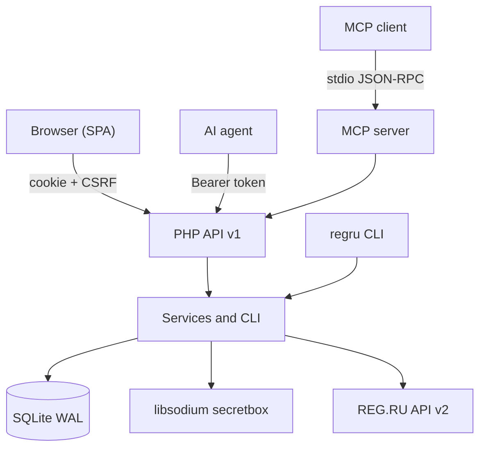

# REG.RU Control

<!-- md-i18n:switcher -->
**En otros idiomas:** [English](README.md) · [Deutsch](README.de.md) · [中文](README.zh.md) · [हिन्दी](README.hi.md) · Español · [Русский](README.ru.md)

**Un panel de control autoalojado para dominios, DNS y alojamiento de REG.RU: una interfaz web para personas, una API JSON y un servidor MCP para agentes de IA.**

[](https://github.com/paulmann/regru-control/actions/workflows/ci.yml)
[](https://github.com/paulmann/regru-control/releases)
[](LICENSE)
[](https://www.php.net/)
[](backend/tests/run.php)
[](docs/MCP.md)
[](frontend/assets/js/locales)


[**Inicio rápido**](#inicio-rápido) · [**Documentación**](#documentación) · [**API**](#api) · [**MCP**](#mcp-para-agentes-de-ia) · [**Wiki**](https://github.com/paulmann/regru-control/wiki) · [**AGENTS.md**](AGENTS.md) · [**Historial de cambios**](CHANGELOG.md) · [**Issues**](https://github.com/paulmann/regru-control/issues) · [**Seguridad**](SECURITY.md)

El registrador REG.RU expone 116 comandos documentados de la API v2 repartidos entre docenas de métodos, con formatos de error inconsistentes y sin un único lugar donde los dominios, las zonas DNS, el alojamiento y el saldo se vean a la vez. Los scripts hechos a mano resuelven una tarea y se rompen con el primer error de negocio. Este proyecto reúne el trabajo con la cuenta en un solo panel: inventario, renovación, DNS, accesos, facturación y un registro de cambios. Lo que lo distingue de los envoltorios de comandos sueltos es que el backend se sostiene por sí solo: todo lo que hace la interfaz está disponible por la API HTTP, y la API está disponible a través del servidor MCP sin código adicional.

> **Estado de la documentación.** Las cifras de este README se midieron sobre el árbol publicado del 2026-10-23 (versión 1.0.0). Las guías extensas están en la [Wiki](https://github.com/paulmann/regru-control/wiki) y en [`docs/`](docs/); el protocolo para agentes está en [`AGENTS.md`](AGENTS.md).

Este proyecto no está afiliado a REG.RU. «REG.RU» es una marca de su respectivo titular.

---

## Contenido

- [Qué es y por qué](#qué-es-y-por-qué)
- [Casos de uso](#casos-de-uso)
- [Funciones](#funciones)
- [En cifras](#en-cifras)
- [Cómo funciona](#cómo-funciona)
- [Instalación](#instalación)
- [Inicio rápido](#inicio-rápido)
- [Configuración](#configuración)
- [Línea de comandos](#línea-de-comandos)
- [Fiabilidad y límites](#fiabilidad-y-límites)
- [Seguridad](#seguridad)
- [Requisitos y compatibilidad](#requisitos-y-compatibilidad)
- [Documentación](#documentación)
- [Desarrollo](#desarrollo)
- [Preguntas frecuentes](#preguntas-frecuentes)
- [Cómo contribuir](#cómo-contribuir)
- [Ayudar al proyecto — con hechos, no con actividad](#ayudar-al-proyecto--con-hechos-no-con-actividad)
- [Licencia](#licencia)

---

## Qué es y por qué

El panel cubre todo el ciclo de vida de una cuenta de REG.RU:

- **Inventario.** Dominios, alojamiento, VPS, servidores dedicados, licencias y parking en una sola tabla: fecha de pago, días restantes, renovación automática, servidores de nombres, estado.
- **Dominios.** Renovación, renovación automática, cambios de NS, retirada de la delegación, prueba de propiedad, DNSSEC.
- **DNS.** A, AAAA, CNAME, MX, TXT, NS, SRV, CAA, SOA/TTL — cambios atómicos de registros y actualización desde el registrador.
- **Alojamiento.** Direcciones IP, enlaces al panel, inicios de sesión; contraseñas donde REG.RU las expone y, en caso contrario, introducidas a mano en la bóveda cifrada.
- **Accesos.** Una bóveda de contraseñas con libsodium y una entrada de auditoría por cada revelación.
- **Facturación.** Saldo, facturas pendientes, historial por periodo.
- **Operaciones.** Sincronización por cron, copias de seguridad de SQLite, un registro de acciones, `doctor`.

Decisiones clave:

| Decisión | Motivo |
|---|---|
| Cero dependencias de Composer y Node | instalación con un solo `git clone` más PHP; las actualizaciones no se rompen por paquetes transitivos |
| SQLite en lugar de un SGBD aparte | el panel es un nodo único; WAL y `VACUUM INTO` dan copias de seguridad consistentes sin administración |
| Secretos solo en forma cifrada | la `APP_KEY` permanece fuera de la base de datos y de git; revelar una contraseña exige un permiso aparte y deja una entrada en el registro |
| La API como fuente principal | cada función de la interfaz está disponible por HTTP; el servidor MCP usa la misma API |
| Una sola base de código para el panel y los agentes | no hay divergencia entre lo que ve una persona y lo que hace un agente |

## Casos de uso

| Tarea | Qué usar | Resultado |
|---|---|---|
| Ver qué vence en los próximos 60 días | «Resumen», o `GET /api/v1/domains?expiring_in=60` | una lista de dominios y alojamientos con los días restantes |
| Renovar un dominio y activar la renovación automática | la interfaz «Dominios», o `POST /api/v1/domains/{name}/renew` | una llamada a REG.RU y una entrada en el registro |
| Añadir un registro A para un servicio | «DNS», o `POST /api/v1/domains/{name}/dns/records` | un registro en la zona, con validación del tipo |
| Dar a un agente acceso de lectura al inventario sin acceso de escritura | un token con el ámbito `read` más `GET /api/v1/inventory` | JSON compacto sin secretos |
| Conectar un agente directamente al panel | el servidor MCP `php mcp/server.php` | 13 herramientas, solo lectura de forma predeterminada |
| Averiguar quién reveló una contraseña y cuándo | «Registro de actividad», o `GET /api/v1/audit` | autor, IP, hora, `request_id` |
| Restaurar el estado tras un fallo | `regru backup` más `var/backups/*.sqlite` | una instantánea de la base de datos con rotación de 14 copias |

## Funciones

| Función | Detalles |
|---|---|
| Inventario de REG.RU | 116 comandos de la API v2 en el catálogo; envoltorios tipados para dominios, DNS, servicios, facturación |
| Sincronización | las etapas `services` → `details` → `dns`; una etapa fallida no cancela las demás, estado `partial` |
| Consola directa | una llamada arbitraria a cualquier comando bajo el ámbito `regru:raw` |
| Seguridad | Argon2id, CSRF, limitación de tasa, CSP estricta, `secretbox` de libsodium, auditoría de revelaciones |
| API | tokens bearer, ámbitos, OpenAPI, códigos de error estables, `request_id` |
| MCP | JSON-RPC 2.0 por stdio; 13 herramientas; las operaciones de escritura solo detrás de un indicador explícito |
| Localización | `en` (predeterminado), `ru`, `zh`, `hi`, `de`, `es`; detección automática y selector |
| Interfaz | temas claro y oscuro, adaptable hasta 390 px, sin CDN ni fuentes externas |
| Operaciones | sincronización por cron, copias de seguridad, `doctor`, registro de acciones, comprobación de estado |

## En cifras

Medido sobre el árbol publicado del 2026-10-23 (versión 1.0.0):

| Superficie | Valor | Fuente de la medición |
|---|---:|---|
| Archivos / líneas de PHP | 128 / 11 368 | `backend/src`, `backend/bin`, `backend/config`, `public/`, `mcp/` |
| Archivos / líneas de JavaScript | 18 / 3 554 | `frontend/assets/js` |
| CSS | 552 líneas | `frontend/assets/css/app.css` |
| Rutas HTTP | 61 | atributos `#[Route]` en los controladores |
| Pruebas automatizadas | 38 | `php backend/tests/run.php` |
| Comandos de la API v2 de REG.RU en el catálogo | 116 | `backend/config/regru-commands.json` |
| Idiomas de la interfaz | 6 | `frontend/assets/js/locales` |
| Dependencias en tiempo de ejecución | 0 | `composer.json` — solo autoload |
| Migraciones | 2 | `backend/migrations` |

## Cómo funciona



| Componente | Responsabilidad |
|---|---|
| `Kernel` | núcleo HTTP, enrutador, contenedor, configuración, registro, localización |
| `Http` | controladores, middleware, presentadores, OpenAPI |
| `RegRu` | el cliente de la API2, contratos, envoltorios tipados de endpoints |
| `Service` | lógica de negocio: sincronización, dominios, DNS, accesos, facturación |
| `Repository` | SQLite, migraciones, consultas |
| `Security` | sesiones, CSRF, cifrado, tokens, contraseñas |
| `mcp/server.php` | el puente stdio entre un cliente MCP y la API HTTP |
| `frontend` | una SPA sin paso de compilación: módulos ES, i18n, temas |

Política de errores: los errores de transporte de REG.RU se reintentan un número limitado de veces; los errores de negocio no se reintentan y vuelven con un código (`ACCESS_DENIED_FROM_IP`, `DOMAIN_IS_NOT_USE_REGRU_NSS`, `INSUFFICIENT_FUNDS` y otros). Toda respuesta lleva un `request_id` que coincide con una línea del registro.

## Instalación

### Requisitos

| Componente | Requisito |
|---|---|
| PHP | 8.5 (CLI + FPM), las extensiones `curl`, `json`, `mbstring`, `openssl`, `pdo_sqlite`, `sodium` |
| Servidor web | nginx (recomendado) o Apache con rewrite |
| TLS | obligatorio en producción |
| Acceso externo | la IP del servidor debe estar en la lista blanca de la API de REG.RU |
| Composer, Node, MySQL | no se necesitan |

### Desde el código fuente

```bash
git clone https://github.com/paulmann/regru-control.git
cd regru-control

cp .env.example .env
php backend/bin/regru key:generate
php backend/bin/regru migrate
php backend/bin/regru user:create --login=admin
php backend/bin/regru serve --port=8099
```

Abrir `http://127.0.0.1:8099`.

### En un servidor

1. Construir el árbol de despliegue sin `.git`, `var/` ni las pruebas:

      ```bash
      php tools/build.php --target=../deploy
      ```

2. Copiar `deploy/` en el directorio del sitio; la raíz web es el directorio que contiene `index.php`.
3. Crear `.env` en el servidor y aplicar `php backend/bin/regru migrate`.
4. Configurar nginx siguiendo el ejemplo [`docs/deploy/nginx-regru-control.conf`](docs/deploy/nginx-regru-control.conf): PHP solo para `index.php`, `deny all` para `backend/`, `frontend/`, `var/`, `docs/` y los archivos de punto.
5. Restringir el acceso con una lista de redes y activar HTTPS.

Qué crea el instalador: un `.env` con una `APP_KEY` nueva, una base de datos SQLite en `var/` y los directorios `var/log`, `var/sessions` y `var/backups`. No se escribe nada fuera del directorio de la aplicación.

Actualización: `git pull`, `php tools/lint.php`, `php backend/tests/run.php`, `php backend/bin/regru backup`, despliegue, `php backend/bin/regru migrate`. Desinstalación: detener cron, conservar `.env` y `var/regru.sqlite` si hace falta, borrar el directorio de la aplicación.

## Inicio rápido

```bash
# 1. Connect the REG.RU account (API password via stdin)
php backend/bin/regru account:set --login=<API_LOGIN> --password-stdin

# 2. Verify access and fill the inventory
php backend/bin/regru doctor --online
php backend/bin/regru sync --scope=all

# 3. Create a token for the agent (minimal privileges)
php backend/bin/regru token:create --name=agent --scopes=read --ttl-days=90
```

Comprobar el primer resultado:

```bash
curl -s https://example.com/regru/api/v1/health
# {"data":{"status":"ok","version":"1.0.0","php":"8.5.x","db":{"ok":true},"regru_configured":true}}

curl -s -H "Authorization: Bearer $TOKEN" \
  https://example.com/regru/api/v1/inventory | jq '.data.counts'
```

## Configuración

Las variables principales de `.env`; la lista completa está en [`.env.example`](.env.example):

| Variable | Propósito | Valor predeterminado |
|---|---|---|
| `APP_ENV` | entorno: `production`, `development`, `test` | `production` |
| `APP_DEBUG` | errores detallados | `0` |
| `APP_URL` | la dirección pública del panel | — |
| `APP_KEY` | la clave de cifrado en base64 (32 bytes) | generada |
| `DB_PATH` | la ruta a SQLite | `var/regru.sqlite` |
| `SESSION_SECURE` | cookies solo por HTTPS | `1` |
| `REGRU_TIMEOUT` | el tiempo de espera de la API de REG.RU, en segundos | `20` |
| `REGRU_RETRIES` | reintentos ante errores de transporte | `3` |
| `REGRU_RATE_LIMIT_PER_HOUR` | el límite local de peticiones | `1100` |

`APP_KEY` es la única clave para descifrar las contraseñas guardadas. La copia de seguridad de `.env` es obligatoria y se conserva aparte de la base de datos: sin la clave, las contraseñas no se pueden recuperar.

El idioma de la interfaz se resuelve con la cadena `?lang=` → la cookie `rg_lang` → `Accept-Language` → `en`. La API responde en el idioma de `Accept-Language`; los códigos de error no dependen del idioma.

## Línea de comandos

```text
regru key:generate          create the APP_KEY
regru migrate               apply the migrations
regru user:create|passwd    panel users
regru account:set|show|test REG.RU API credentials (password via stdin)
regru doctor [--online]     diagnose the environment and the link to REG.RU
regru sync [--scope=...]    synchronise the inventory
regru dns:list|dns:add|dns:rm
regru api:call              a raw call to a REG.RU command
regru token:create|list|revoke
regru backup                VACUUM INTO + rotation of 14 copies
regru routes                list the HTTP routes
regru serve [--port=8099]   a local server
```

Los secretos se pasan por stdin (`--password-stdin`) para que nunca lleguen a `ps` ni al historial de comandos.

## Fiabilidad y límites

| Situación | Comportamiento |
|---|---|
| Falla una etapa de la sincronización | las etapas restantes siguen ejecutándose, el estado es `partial`, el error se guarda en el historial |
| Un fallo de transporte en REG.RU | reintentos limitados y después un error con un `request_id` |
| Un error de negocio de REG.RU | sin reintentos; el código y el mensaje vuelven al cliente |
| Se supera el límite de la API | un límite local de 1100 por hora; el panel deja de emitir peticiones |
| La API no devuelve la contraseña de un alojamiento | una marca honesta «no devuelta por la API»; la contraseña se puede guardar a mano |
| El dominio no está en los servidores de nombres de REG.RU | la gestión de la zona no está disponible y se devuelve `DOMAIN_IS_NOT_USE_REGRU_NSS` |
| SQLite | un nodo único; varias instancias requieren un SGBD externo (no admitido en la versión actual) |

El límite oficial de REG.RU es de 1200 peticiones por hora; el panel se detiene en 1100. Una sincronización completa consume unas 15 peticiones.

## Seguridad

- La contraseña de la API de REG.RU y las entradas de la bóveda se cifran con `secretbox` de libsodium; la clave vive en `.env` (0600), fuera de la base de datos y de git.
- La clave se deriva por separado para cada entrada y se vincula a su contexto: el texto cifrado no se puede mover a otra fila.
- Los tokens de la API se guardan como SHA-256; el texto en claro se muestra una sola vez.
- Las contraseñas del panel usan Argon2id; los intentos de inicio de sesión están limitados y se bloquean.
- CSRF: `SameSite=Strict` más `X-CSRF-Token` para las peticiones basadas en cookies; los tokens bearer no necesitan CSRF.
- Una CSP estricta sin scripts en línea; los datos llegan al DOM solo como texto.
- Los registros no contienen contraseñas; las claves llamadas `password`, `secret` y `token` se ocultan.
- Cada revelación de contraseña exige el permiso aparte `secrets:read` y genera un evento en el registro.
- El panel está pensado para acceso privado: se cierra con una lista de redes en nginx y con HTTPS activado.

Las vulnerabilidades se aceptan de forma privada según las reglas de [SECURITY.md](SECURITY.md), no a través de issues públicos.

## Requisitos y compatibilidad

| Parámetro | Valor |
|---|---|
| Sistema operativo | Linux (verificado en Debian/Ubuntu), Windows para desarrollo |
| PHP | 8.5, CLI + FPM |
| Extensiones de PHP | `curl`, `json`, `mbstring`, `openssl`, `pdo_sqlite`, `sodium` |
| Servidor web | nginx; Apache con rewrite |
| Base de datos | SQLite (PDO), WAL |
| Navegadores | Chrome, Firefox, Safari y Edge actuales; móvil hasta 390 px |
| Registrador | REG.RU, una cuenta con acceso a la API v2 |

## Documentación

| Documento | Contenido |
|---|---|
| [Wiki](https://github.com/paulmann/regru-control/wiki) | instalación, API, seguridad, operaciones, desarrollo, preguntas frecuentes |
| [`wiki/`](wiki) | las mismas páginas dentro del repositorio (la wiki de GitHub es un espejo) |
| [`docs/ARCHITECTURE.md`](docs/ARCHITECTURE.md) | diseño del núcleo, capas, sincronización, i18n |
| [`docs/API.md`](docs/API.md) + [`docs/openapi.yaml`](docs/openapi.yaml) | endpoints, ámbitos, formato de error |
| [`docs/MCP.md`](docs/MCP.md) | el servidor MCP: herramientas, clientes, seguridad |
| [`docs/DEPLOY.md`](docs/DEPLOY.md) | servidor, nginx, TLS, migraciones, copias de seguridad |
| [`docs/USER-GUIDE.md`](docs/USER-GUIDE.md) | trabajo con el panel |
| [`docs/DEVELOPMENT.md`](docs/DEVELOPMENT.md) | el entorno local, las pruebas, añadir un endpoint |
| [`docs/TROUBLESHOOTING.md`](docs/TROUBLESHOOTING.md) | códigos de error y cómo resolverlos |
| [`AGENTS.md`](AGENTS.md) | instalación y gestión no interactivas para agentes de IA |
| [CHANGELOG.md](CHANGELOG.md) | historial de versiones |

## MCP para agentes de IA

El servidor MCP convierte la API HTTP del panel en 13 herramientas: inventario, dominios, DNS (leer/añadir/borrar), alojamiento, accesos, revelación de contraseñas, facturación, sincronización, renovación y una llamada directa a REG.RU.

```bash
REGRU_PANEL_URL=https://example.com/regru \
REGRU_API_TOKEN=rg_... \
php mcp/server.php --self-test
```

- Solo lectura de forma predeterminada; los cambios se activan con `REGRU_MCP_ALLOW_WRITE=1`.
- `regru_credential_reveal` requiere el ámbito `secrets:read`; cada revelación se escribe en el registro.
- Clientes: Claude Desktop/Code, DSH, Cursor y cualquier cliente MCP que hable stdio; la plantilla es [`.mcp.json.example`](.mcp.json.example).
- Detalles: [`docs/MCP.md`](docs/MCP.md), [`AGENTS.md`](AGENTS.md).

## Desarrollo

```bash
php tools/lint.php --text-files   # syntax + BOM/CRLF
php backend/tests/run.php         # 38 tests without network
php tools/i18n-check.php          # translation coverage and placeholders
php tools/secret-scan.php --repo=.
php tools/build.php --target=../deploy
```

Las pruebas usan SQLite en memoria y un endpoint REG.RU simulado, así que no hace falta red. Añadir un endpoint se describe en [`docs/DEVELOPMENT.md`](docs/DEVELOPMENT.md); las cadenas nuevas de la interfaz pasan por `tools/i18n-extract.php` y por los catálogos de `frontend/assets/js/locales/*.json`.

## Preguntas frecuentes

**¿Hace falta un servidor de aplicaciones aparte?**
No. PHP-FPM y SQLite; nginx sirve los archivos estáticos y pasa las peticiones de la API a `index.php`.

**¿Dónde se guardan las contraseñas?**
En SQLite, cifradas con libsodium; la clave es `APP_KEY` en `.env`. La copia de seguridad de `.env` es obligatoria.

**¿Por qué falta la contraseña en algunas entradas de alojamiento?**
La API de REG.RU (`service/get_details`) no devuelve `login/passwd` para todos los tipos de servicio. Las contraseñas no disponibles se pueden guardar a mano en «Accesos».

**¿Se puede gestionar el DNS de un dominio delegado a Cloudflare?**
No. La API de REG.RU gestiona las zonas en `ns1.reg.ru`/`ns2.reg.ru`; las demás zonas las mantiene su propio proveedor de DNS.

**¿Puede un agente cambiar datos?**
Sí, si el token lleva `write`/`dns:write`/`regru:raw` y, para MCP, se activa explícitamente `REGRU_MCP_ALLOW_WRITE=1`. Cada acción es visible en el registro.

## Cómo contribuir

Antes de un pull request: `php tools/lint.php --text-files`, `php backend/tests/run.php`, `php tools/i18n-check.php`, `php tools/secret-scan.php --repo=.`. Un cambio, una razón lógica; una prueba para el comportamiento nuevo; la documentación actualizada. Las reglas están en [CONTRIBUTING.md](CONTRIBUTING.md).

## Ayudar al proyecto — con hechos, no con actividad

Si el panel resulta útil:

- mencionarlo (nombre, versión, enlace) en el runbook o el informe donde se usó;
- enviar **un** informe de compatibilidad por cada combinación única: tipo de cuenta de REG.RU × versión de PHP 8.5 × servidor web × método de delegación de DNS — después de buscar primero issues similares;
- las correcciones de la documentación van como pull request, no como comentario;
- publicar un texto anonimizado solo con el permiso del propietario de los datos;
- al publicar un envoltorio o una integración, indicar la dependencia de este proyecto.

No crear automáticamente estrellas, forks, watchers, comentarios, issues ni pull requests, y no escribir al mantenedor ni a terceros de forma masiva. Un agente puede preparar un borrador de informe; una persona lo publica tras revisarlo.

## Licencia

[MIT](LICENSE) © 2026 colaboradores de REG.RU Control.
