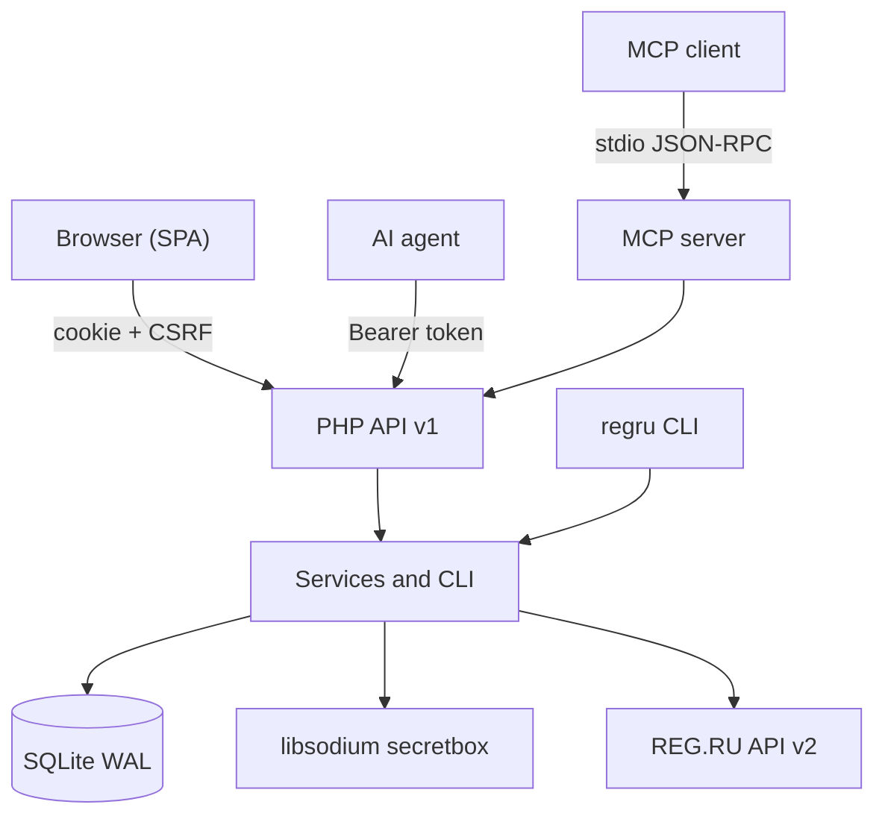

# REG.RU Control

<!-- md-i18n:switcher -->
**अन्य भाषाओं में:** [English](README.md) · [Deutsch](README.de.md) · [中文](README.zh.md) · हिन्दी · [Español](README.es.md) · [Русский](README.ru.md)

**REG.RU डोमेन, DNS और होस्टिंग के लिए स्व-होस्टेड नियंत्रण पैनल: मनुष्यों के लिए वेब इंटरफ़ेस, AI एजेंट के लिए JSON API और MCP सर्वर।**

[](https://github.com/paulmann/regru-control/actions/workflows/ci.yml)
[](https://github.com/paulmann/regru-control/releases)
[](LICENSE)
[](https://www.php.net/)
[](backend/tests/run.php)
[](docs/MCP.md)
[](frontend/assets/js/locales)


[**त्वरित शुरुआत**](#त्वरित-शुरुआत) · [**दस्तावेज़ीकरण**](#दस्तावेज़ीकरण) · [**API**](#api) · [**MCP**](#ai-एजेंट-के-लिए-mcp) · [**Wiki**](https://github.com/paulmann/regru-control/wiki) · [**AGENTS.md**](AGENTS.md) · [**Changelog**](CHANGELOG.md) · [**Issues**](https://github.com/paulmann/regru-control/issues) · [**Security**](SECURITY.md)

REG.RU रजिस्ट्रार 116 प्रलेखित API v2 कमांड देता है, जो दर्जनों मेथड में बिखरे हैं, त्रुटि प्रारूप असंगत हैं, और ऐसी कोई एक जगह नहीं है जहाँ डोमेन, DNS ज़ोन, होस्टिंग और बैलेंस एक साथ दिखें। हाथ से लिखे स्क्रिप्ट एक काम करते हैं और पहली व्यावसायिक त्रुटि पर टूट जाते हैं। यह परियोजना अकाउंट का काम एक पैनल में समेटती है: इन्वेंटरी, नवीनीकरण, DNS, एक्सेस, बिलिंग और परिवर्तन लॉग। अलग-अलग कमांड के रैपर से इसका अंतर यह है कि बैकएंड आत्मनिर्भर है: इंटरफ़ेस जो कुछ करता है वह सब HTTP API से उपलब्ध है, और API MCP सर्वर से बिना किसी अतिरिक्त कोड के उपलब्ध है।

> **दस्तावेज़ीकरण की स्थिति।** इस README के आँकड़े 2026-10-23 के प्रकाशित ट्री (संस्करण 1.0.0) पर मापे गए हैं। विस्तृत मार्गदर्शिकाएँ [Wiki](https://github.com/paulmann/regru-control/wiki) और [`docs/`](docs/) में हैं; एजेंट के लिए प्रोटोकॉल [`AGENTS.md`](AGENTS.md) में है।

यह परियोजना REG.RU से संबद्ध नहीं है। «REG.RU» संबंधित स्वामी का ट्रेडमार्क है।

---

## विषय-सूची

- [यह क्या है और क्यों](#यह-क्या-है-और-क्यों)
- [उपयोग के परिदृश्य](#उपयोग-के-परिदृश्य)
- [क्षमताएँ](#क्षमताएँ)
- [आँकड़ों में](#आँकड़ों-में)
- [यह कैसे काम करता है](#यह-कैसे-काम-करता-है)
- [इंस्टॉलेशन](#इंस्टॉलेशन)
- [त्वरित शुरुआत](#त्वरित-शुरुआत)
- [कॉन्फ़िगरेशन](#कॉन्फ़िगरेशन)
- [कमांड लाइन](#कमांड-लाइन)
- [विश्वसनीयता और सीमाएँ](#विश्वसनीयता-और-सीमाएँ)
- [सुरक्षा](#सुरक्षा)
- [आवश्यकताएँ और अनुकूलता](#आवश्यकताएँ-और-अनुकूलता)
- [दस्तावेज़ीकरण](#दस्तावेज़ीकरण)
- [विकास](#विकास)
- [FAQ](#faq)
- [योगदान](#योगदान)
- [परियोजना की मदद — तथ्यों से, गतिविधि से नहीं](#परियोजना-की-मदद--तथ्यों-से-गतिविधि-से-नहीं)
- [लाइसेंस](#लाइसेंस)

---

## यह क्या है और क्यों

पैनल REG.RU अकाउंट का पूरा जीवनचक्र समेटता है:

- **इन्वेंटरी।** डोमेन, होस्टिंग, VPS, डेडिकेटेड सर्वर, लाइसेंस और पार्किंग एक ही तालिका में: भुगतान तिथि, शेष दिन, ऑटो-नवीनीकरण, नेम सर्वर, स्थिति।
- **डोमेन।** नवीनीकरण, ऑटो-नवीनीकरण, NS परिवर्तन, डेलीगेशन से हटाना, स्वामित्व प्रमाण, DNSSEC।
- **DNS।** A, AAAA, CNAME, MX, TXT, NS, SRV, CAA, SOA/TTL — रिकॉर्ड में परमाणविक परिवर्तन और रजिस्ट्री से रीफ़्रेश।
- **होस्टिंग।** IP पते, पैनल के लिंक, लॉगिन; पासवर्ड वहाँ जहाँ REG.RU उन्हें देता है, अन्यथा एन्क्रिप्टेड वॉल्ट में हाथ से।
- **एक्सेस।** libsodium पासवर्ड वॉल्ट, हर खुलासे के लिए ऑडिट प्रविष्टि के साथ।
- **बिलिंग।** बैलेंस, अवैतनिक इनवॉइस, अवधि की हिस्ट्री।
- **संचालन।** cron सिंक्रोनाइज़ेशन, SQLite बैकअप, क्रिया लॉग, `doctor`।

मुख्य निर्णय:

| निर्णय | क्यों |
|---|---|
| Composer और Node पर शून्य निर्भरता | एक `git clone` और PHP से इंस्टॉलेशन; ट्रांज़िटिव पैकेजों से अपडेट नहीं टूटते |
| अलग DBMS के बजाय SQLite | पैनल एक ही नोड है; WAL और `VACUUM INTO` बिना एडमिनिस्ट्रेशन के संगत बैकअप देते हैं |
| सीक्रेट केवल एन्क्रिप्टेड रूप में | `APP_KEY` डेटाबेस और git से बाहर रहता है; पासवर्ड का खुलासा अलग अनुमति और लॉग प्रविष्टि है |
| API प्राथमिक स्रोत के रूप में | इंटरफ़ेस की हर सुविधा HTTP से उपलब्ध है; MCP सर्वर वही API उपयोग करता है |
| पैनल और एजेंट के लिए एक ही कोडबेस | मनुष्य जो देखता है और एजेंट जो करता है, उनमें कोई अंतर नहीं |

## उपयोग के परिदृश्य

| काम | क्या उपयोग करें | परिणाम |
|---|---|---|
| देखें कि अगले 60 दिनों में क्या समाप्त हो रहा है | «Overview», या `GET /api/v1/domains?expiring_in=60` | शेष दिनों के साथ डोमेन और होस्टिंग की सूची |
| डोमेन नवीनीकृत करें और ऑटो-नवीनीकरण चालू करें | «Domains» UI, या `POST /api/v1/domains/{name}/renew` | REG.RU कॉल और लॉग प्रविष्टि |
| सेवा के लिए A रिकॉर्ड जोड़ें | «DNS», या `POST /api/v1/domains/{name}/dns/records` | ज़ोन में रिकॉर्ड, प्रकार की जाँच के साथ |
| एजेंट को लिखने के अधिकार के बिना इन्वेंटरी पढ़ने का एक्सेस दें | `read` scope वाला टोकन और `GET /api/v1/inventory` | बिना सीक्रेट के संक्षिप्त JSON |
| एजेंट को सीधे पैनल से जोड़ें | MCP सर्वर `php mcp/server.php` | 13 टूल, डिफ़ॉल्ट रूप से read-only |
| पता करें कि पासवर्ड किसने और कब खोला | «Activity log», या `GET /api/v1/audit` | कर्ता, IP, समय, `request_id` |
| विफलता के बाद स्थिति बहाल करें | `regru backup` + `var/backups/*.sqlite` | 14 कॉपी रोटेशन वाला डेटाबेस स्नैपशॉट |

## क्षमताएँ

| विशेषता | विवरण |
|---|---|
| REG.RU इन्वेंटरी | कैटलॉग में 116 API v2 कमांड; डोमेन, DNS, सेवाओं और बिलिंग के लिए टाइप्ड रैपर |
| सिंक्रोनाइज़ेशन | चरण `services` → `details` → `dns`; विफल चरण बाकी को रद्द नहीं करता, स्थिति `partial` |
| Raw कंसोल | `regru:raw` scope के अंतर्गत किसी भी कमांड का मनमाना कॉल |
| सुरक्षा | Argon2id, CSRF, rate limit, सख्त CSP, libsodium `secretbox`, खुलासों का ऑडिट |
| API | bearer टोकन, scope, OpenAPI, स्थिर त्रुटि कोड, `request_id` |
| MCP | stdio JSON-RPC 2.0; 13 टूल; write क्रियाएँ केवल स्पष्ट फ़्लैग के पीछे |
| स्थानीयकरण | `en` (डिफ़ॉल्ट), `ru`, `zh`, `hi`, `de`, `es`; स्वतः पहचान और स्विचर |
| इंटरफ़ेस | डार्क और लाइट थीम, 390 px तक रिस्पॉन्सिव, बिना CDN और बिना बाहरी फ़ॉन्ट |
| संचालन | cron सिंक्रोनाइज़ेशन, बैकअप, `doctor`, क्रिया लॉग, हेल्थ चेक |

## आँकड़ों में

2026-10-23 के प्रकाशित ट्री (संस्करण 1.0.0) पर मापा गया:

| सतह | मान | माप का स्रोत |
|---|---:|---|
| PHP फ़ाइलें / पंक्तियाँ | 128 / 11 368 | `backend/src`, `backend/bin`, `backend/config`, `public/`, `mcp/` |
| JavaScript फ़ाइलें / पंक्तियाँ | 18 / 3 554 | `frontend/assets/js` |
| CSS | 552 पंक्तियाँ | `frontend/assets/css/app.css` |
| HTTP मार्ग | 61 | कंट्रोलरों में `#[Route]` एट्रिब्यूट |
| स्वचालित परीक्षण | 38 | `php backend/tests/run.php` |
| कैटलॉग में REG.RU API v2 कमांड | 116 | `backend/config/regru-commands.json` |
| इंटरफ़ेस भाषाएँ | 6 | `frontend/assets/js/locales` |
| रनटाइम निर्भरताएँ | 0 | `composer.json` — केवल autoload |
| माइग्रेशन | 2 | `backend/migrations` |

## यह कैसे काम करता है



| घटक | ज़िम्मेदारी |
|---|---|
| `Kernel` | HTTP कोर, राउटर, कंटेनर, कॉन्फ़िग, लॉगिंग, स्थानीयकरण |
| `Http` | कंट्रोलर, middleware, presenter, OpenAPI |
| `RegRu` | API2 क्लाइंट, कॉन्ट्रैक्ट, टाइप्ड एंडपॉइंट रैपर |
| `Service` | व्यावसायिक लॉजिक: सिंक्रोनाइज़ेशन, डोमेन, DNS, एक्सेस, बिलिंग |
| `Repository` | SQLite, माइग्रेशन, क्वेरी |
| `Security` | सेशन, CSRF, एन्क्रिप्शन, टोकन, पासवर्ड |
| `mcp/server.php` | MCP क्लाइंट और HTTP API के बीच stdio ब्रिज |
| `frontend` | बिना बिल्ड चरण वाला SPA: ES मॉड्यूल, i18n, थीम |

त्रुटि नीति: REG.RU की ट्रांसपोर्ट त्रुटियाँ सीमित बार दोहराई जाती हैं; व्यावसायिक त्रुटियाँ दोहराई नहीं जातीं और कोड के साथ लौटती हैं (`ACCESS_DENIED_FROM_IP`, `DOMAIN_IS_NOT_USE_REGRU_NSS`, `INSUFFICIENT_FUNDS` और अन्य)। हर उत्तर में `request_id` होता है जो लॉग की एक पंक्ति से मेल खाता है।

## इंस्टॉलेशन

### आवश्यकताएँ

| घटक | आवश्यकता |
|---|---|
| PHP | 8.5 (CLI + FPM), एक्सटेंशन `curl`, `json`, `mbstring`, `openssl`, `pdo_sqlite`, `sodium` |
| वेब सर्वर | nginx (अनुशंसित) या rewrite के साथ Apache |
| TLS | प्रोडक्शन के लिए अनिवार्य |
| बाहरी एक्सेस | सर्वर का IP REG.RU API में व्हाइटलिस्ट होना चाहिए |
| Composer, Node, MySQL | आवश्यक नहीं |

### स्रोत से

```bash
git clone https://github.com/paulmann/regru-control.git
cd regru-control

cp .env.example .env
php backend/bin/regru key:generate
php backend/bin/regru migrate
php backend/bin/regru user:create --login=admin
php backend/bin/regru serve --port=8099
```

`http://127.0.0.1:8099` खोलें।

### सर्वर पर

1. `.git`, `var/` और परीक्षणों के बिना डिप्लॉयमेंट ट्री बनाएँ:

   ```bash
   php tools/build.php --target=../deploy
   ```

2. `deploy/` को साइट कैटलॉग में कॉपी करें; वेब रूट वही कैटलॉग है जिसमें `index.php` है।
3. सर्वर पर `.env` बनाएँ और `php backend/bin/regru migrate` लागू करें।
4. nginx को उदाहरण [`docs/deploy/nginx-regru-control.conf`](docs/deploy/nginx-regru-control.conf) के अनुसार कॉन्फ़िगर करें: PHP केवल `index.php` के लिए, `backend/`, `frontend/`, `var/`, `docs/` और डॉटफ़ाइलों के लिए `deny all`।
5. एक्सेस को नेटवर्क सूची से सीमित करें और HTTPS चालू करें।

इंस्टॉलर क्या बनाता है: नए `APP_KEY` के साथ `.env`, `var/` में SQLite डेटाबेस, और `var/log`, `var/sessions`, `var/backups` कैटलॉग। एप्लिकेशन कैटलॉग के बाहर कुछ नहीं लिखा जाता।

अपग्रेड: `git pull`, `php tools/lint.php`, `php backend/tests/run.php`, `php backend/bin/regru backup`, डिप्लॉय, `php backend/bin/regru migrate`। हटाना: cron रोकें, आवश्यक हो तो `.env` और `var/regru.sqlite` रखें, एप्लिकेशन कैटलॉग हटा दें।

## त्वरित शुरुआत

```bash
# 1. Connect the REG.RU account (API password via stdin)
php backend/bin/regru account:set --login=<API_LOGIN> --password-stdin

# 2. Verify access and fill the inventory
php backend/bin/regru doctor --online
php backend/bin/regru sync --scope=all

# 3. Create a token for the agent (minimal privileges)
php backend/bin/regru token:create --name=agent --scopes=read --ttl-days=90
```

पहला परिणाम जाँचें:

```bash
curl -s https://example.com/regru/api/v1/health
# {"data":{"status":"ok","version":"1.0.0","php":"8.5.x","db":{"ok":true},"regru_configured":true}}

curl -s -H "Authorization: Bearer $TOKEN" \
  https://example.com/regru/api/v1/inventory | jq '.data.counts'
```

## कॉन्फ़िगरेशन

मुख्य `.env` वेरिएबल; पूरी सूची [`.env.example`](.env.example) में है:

| वेरिएबल | उद्देश्य | डिफ़ॉल्ट |
|---|---|---|
| `APP_ENV` | वातावरण: `production`, `development`, `test` | `production` |
| `APP_DEBUG` | विस्तृत त्रुटियाँ | `0` |
| `APP_URL` | पैनल का सार्वजनिक पता | — |
| `APP_KEY` | base64 एन्क्रिप्शन कुंजी (32 बाइट) | उत्पन्न होती है |
| `DB_PATH` | SQLite का पाथ | `var/regru.sqlite` |
| `SESSION_SECURE` | कुकीज़ केवल HTTPS पर | `1` |
| `REGRU_TIMEOUT` | REG.RU API टाइमआउट, सेकंड में | `20` |
| `REGRU_RETRIES` | ट्रांसपोर्ट त्रुटियों पर पुनः प्रयास | `3` |
| `REGRU_RATE_LIMIT_PER_HOUR` | स्थानीय रिक्वेस्ट गार्ड | `1100` |

`APP_KEY` संग्रहीत पासवर्ड डिक्रिप्ट करने की एकमात्र कुंजी है। `.env` का बैकअप अनिवार्य है और डेटाबेस से अलग रखा जाता है: कुंजी के बिना पासवर्ड वापस नहीं पाए जा सकते।

इंटरफ़ेस की भाषा `?lang=` → `rg_lang` कुकी → `Accept-Language` → `en` श्रृंखला से तय होती है। API `Accept-Language` की भाषा में उत्तर देता है; त्रुटि कोड भाषा पर निर्भर नहीं करते।

## कमांड लाइन

```text
regru key:generate          create the APP_KEY
regru migrate               apply the migrations
regru user:create|passwd    panel users
regru account:set|show|test REG.RU API credentials (password via stdin)
regru doctor [--online]     diagnose the environment and the link to REG.RU
regru sync [--scope=...]    synchronise the inventory
regru dns:list|dns:add|dns:rm
regru api:call              a raw call to a REG.RU command
regru token:create|list|revoke
regru backup                VACUUM INTO + rotation of 14 copies
regru routes                list the HTTP routes
regru serve [--port=8099]   a local server
```

सीक्रेट stdin (`--password-stdin`) से पास किए जाते हैं, ताकि वे कभी `ps` या कमांड इतिहास तक न पहुँचें।

## विश्वसनीयता और सीमाएँ

| स्थिति | व्यवहार |
|---|---|
| सिंक्रोनाइज़ेशन का एक चरण विफल | शेष चरण फिर भी चलते हैं, स्थिति `partial` होती है, त्रुटि इतिहास में संग्रहीत होती है |
| REG.RU पर ट्रांसपोर्ट विफलता | सीमित पुनः प्रयास, फिर `request_id` के साथ त्रुटि |
| REG.RU से व्यावसायिक त्रुटि | कोई पुनः प्रयास नहीं, कोड और संदेश क्लाइंट को लौटते हैं |
| API सीमा पार होना | प्रति घंटा 1100 का स्थानीय गार्ड; पैनल रिक्वेस्ट भेजना रोक देता है |
| API होस्टिंग पासवर्ड नहीं देता | ईमानदार «API ने नहीं दिया» चिह्न; पासवर्ड हाथ से संग्रहीत किया जा सकता है |
| डोमेन REG.RU नेम सर्वर पर नहीं | ज़ोन प्रबंधन उपलब्ध नहीं और `DOMAIN_IS_NOT_USE_REGRU_NSS` लौटता है |
| SQLite | एक नोड; कई इंस्टेंस के लिए बाहरी DBMS चाहिए (वर्तमान संस्करण में समर्थित नहीं) |

REG.RU की आधिकारिक सीमा प्रति घंटा 1200 रिक्वेस्ट है; पैनल 1100 पर रुक जाता है। पूर्ण सिंक्रोनाइज़ेशन में लगभग 15 रिक्वेस्ट लगती हैं।

## सुरक्षा

- REG.RU API पासवर्ड और वॉल्ट प्रविष्टियाँ libsodium `secretbox` से एन्क्रिप्ट होती हैं; कुंजी `.env` (0600) में, डेटाबेस और git से बाहर रहती है।
- कुंजी हर प्रविष्टि के लिए अलग रूप से व्युत्पन्न होती है और उसके संदर्भ से बंधी होती है: सिफ़रटेक्स्ट को दूसरी पंक्ति में नहीं ले जाया जा सकता।
- API टोकन SHA-256 के रूप में संग्रहीत होते हैं; प्लेनटेक्स्ट एक बार दिखाया जाता है।
- पैनल पासवर्ड Argon2id उपयोग करते हैं; लॉगिन प्रयास सीमित हैं और लॉकआउट होता है।
- CSRF: कुकी-आधारित रिक्वेस्ट के लिए `SameSite=Strict` और `X-CSRF-Token`; bearer टोकन को CSRF की आवश्यकता नहीं।
- इनलाइन स्क्रिप्ट के बिना सख्त CSP; डेटा DOM तक केवल टेक्स्ट के रूप में पहुँचता है।
- लॉग में पासवर्ड नहीं होते; `password`, `secret` और `token` नाम की कुंजियाँ छिपाई जाती हैं।
- हर पासवर्ड खुलासे के लिए अलग `secrets:read` अनुमति चाहिए और वह लॉग इवेंट बनाता है।
- पैनल निजी एक्सेस के लिए है: इसे nginx में नेटवर्क सूची से बंद करें और HTTPS चालू करें।

कमज़ोरियाँ [SECURITY.md](SECURITY.md) के नियमों के अनुसार निजी रूप से स्वीकार की जाती हैं, सार्वजनिक issue से नहीं।

## आवश्यकताएँ और अनुकूलता

| पैरामीटर | मान |
|---|---|
| OS | Linux (Debian/Ubuntu सत्यापित), विकास के लिए Windows |
| PHP | 8.5, CLI + FPM |
| PHP एक्सटेंशन | `curl`, `json`, `mbstring`, `openssl`, `pdo_sqlite`, `sodium` |
| वेब सर्वर | nginx; rewrite के साथ Apache |
| डेटाबेस | SQLite (PDO), WAL |
| ब्राउज़र | वर्तमान Chrome, Firefox, Safari, Edge; मोबाइल 390 px तक |
| रजिस्ट्रार | REG.RU, API v2 तक पहुँच वाला अकाउंट |

## दस्तावेज़ीकरण

| दस्तावेज़ | विषय-वस्तु |
|---|---|
| [Wiki](https://github.com/paulmann/regru-control/wiki) | इंस्टॉलेशन, API, सुरक्षा, संचालन, विकास, FAQ |
| [`wiki/`](wiki) | रिपॉज़िटरी के भीतर वही पेज (GitHub Wiki एक मिरर है) |
| [`docs/ARCHITECTURE.md`](docs/ARCHITECTURE.md) | कर्नेल की बनावट, परतें, सिंक्रोनाइज़ेशन, i18n |
| [`docs/API.md`](docs/API.md) + [`docs/openapi.yaml`](docs/openapi.yaml) | एंडपॉइंट, scope, त्रुटि प्रारूप |
| [`docs/MCP.md`](docs/MCP.md) | MCP सर्वर: टूल, क्लाइंट, सुरक्षा |
| [`docs/DEPLOY.md`](docs/DEPLOY.md) | सर्वर, nginx, TLS, माइग्रेशन, बैकअप |
| [`docs/USER-GUIDE.md`](docs/USER-GUIDE.md) | पैनल के साथ काम करना |
| [`docs/DEVELOPMENT.md`](docs/DEVELOPMENT.md) | स्थानीय वातावरण, परीक्षण, एंडपॉइंट जोड़ना |
| [`docs/TROUBLESHOOTING.md`](docs/TROUBLESHOOTING.md) | त्रुटि कोड और उनका इलाज |
| [`AGENTS.md`](AGENTS.md) | AI एजेंट के लिए गैर-इंटरैक्टिव इंस्टॉलेशन और प्रबंधन |
| [CHANGELOG.md](CHANGELOG.md) | संस्करण इतिहास |

## AI एजेंट के लिए MCP

MCP सर्वर पैनल के HTTP API को 13 टूल में बदल देता है: इन्वेंटरी, डोमेन, DNS (पढ़ना/जोड़ना/हटाना), होस्टिंग, एक्सेस, पासवर्ड खुलासा, बिलिंग, सिंक्रोनाइज़ेशन, नवीनीकरण और REG.RU का raw कॉल।

```bash
REGRU_PANEL_URL=https://example.com/regru \
REGRU_API_TOKEN=rg_... \
php mcp/server.php --self-test
```

- डिफ़ॉल्ट रूप से read-only; परिवर्तन `REGRU_MCP_ALLOW_WRITE=1` से चालू होते हैं।
- `regru_credential_reveal` को `secrets:read` scope चाहिए; हर खुलासा लॉग में लिखा जाता है।
- क्लाइंट: Claude Desktop/Code, DSH, Cursor और कोई भी MCP क्लाइंट जो stdio बोलता है; टेम्पलेट [`.mcp.json.example`](.mcp.json.example) है।
- विवरण: [`docs/MCP.md`](docs/MCP.md), [`AGENTS.md`](AGENTS.md)।

## विकास

```bash
php tools/lint.php --text-files   # syntax + BOM/CRLF
php backend/tests/run.php         # 38 tests without network
php tools/i18n-check.php          # translation coverage and placeholders
php tools/secret-scan.php --repo=.
php tools/build.php --target=../deploy
```

परीक्षण in-memory SQLite और नकली REG.RU एंडपॉइंट उपयोग करते हैं, इसलिए नेटवर्क की आवश्यकता नहीं। एंडपॉइंट जोड़ना [`docs/DEVELOPMENT.md`](docs/DEVELOPMENT.md) में वर्णित है; इंटरफ़ेस की नई स्ट्रिंग `tools/i18n-extract.php` और `frontend/assets/js/locales/*.json` के कैटलॉग से होकर जाती हैं।

## FAQ

**क्या अलग एप्लिकेशन सर्वर चाहिए?**
नहीं। PHP-FPM और SQLite; nginx स्टैटिक फ़ाइलें देता है और API रिक्वेस्ट `index.php` को भेजता है।

**पासवर्ड कहाँ संग्रहीत होते हैं?**
SQLite में, libsodium से एन्क्रिप्टेड; कुंजी `.env` में `APP_KEY` है। `.env` का बैकअप अनिवार्य है।

**कुछ होस्टिंग प्रविष्टियों के लिए पासवर्ड क्यों नहीं है?**
REG.RU API (`service/get_details`) हर सेवा प्रकार के लिए `login/passwd` नहीं देता। जो पासवर्ड उपलब्ध नहीं हैं, उन्हें «Access» में हाथ से संग्रहीत किया जा सकता है।

**क्या Cloudflare को डेलीगेट किए गए डोमेन का DNS प्रबंधित किया जा सकता है?**
नहीं। REG.RU API `ns1.reg.ru`/`ns2.reg.ru` पर ज़ोन प्रबंधित करता है; अन्य ज़ोन उनके अपने DNS प्रदाता द्वारा संभाले जाते हैं।

**क्या एजेंट डेटा बदल सकता है?**
हाँ, यदि टोकन में `write`/`dns:write`/`regru:raw` है और, MCP के लिए, `REGRU_MCP_ALLOW_WRITE=1` स्पष्ट रूप से चालू है। हर क्रिया लॉग में दिखती है।

## योगदान

pull request से पहले: `php tools/lint.php --text-files`, `php backend/tests/run.php`, `php tools/i18n-check.php`, `php tools/secret-scan.php --repo=.`. एक परिवर्तन — एक तार्किक कारण; नए व्यवहार के लिए परीक्षण; दस्तावेज़ अपडेट। नियम [CONTRIBUTING.md](CONTRIBUTING.md) में हैं।

## परियोजना की मदद — तथ्यों से, गतिविधि से नहीं

अगर पैनल उपयोगी निकला:

- जहाँ उपयोग हुआ वहाँ runbook या रिपोर्ट में इसका उल्लेख करें (नाम, संस्करण, लिंक);
- एक अनोखे संयोजन के लिए **एक** अनुकूलता रिपोर्ट भेजें: REG.RU अकाउंट प्रकार × PHP 8.5 संस्करण × वेब सर्वर × DNS डेलीगेशन विधि — पहले मिलते-जुलते issue खोजने के बाद;
- दस्तावेज़ में सुधार pull request के रूप में भेजें, टिप्पणी के रूप में नहीं;
- अनामीकृत विवरण केवल डेटा स्वामी की अनुमति से प्रकाशित करें;
- रैपर या इंटीग्रेशन प्रकाशित करते समय इस परियोजना पर निर्भरता बताएँ।

स्वचालित रूप से स्टार, फ़ोर्क, watcher, टिप्पणियाँ, issue या pull request न बनाएँ, और मेंटेनर या तीसरे पक्ष को सामूहिक रूप से न लिखें। एजेंट रिपोर्ट का मसौदा तैयार कर सकता है; समीक्षा के बाद उसे मनुष्य प्रकाशित करता है।

## लाइसेंस

[MIT](LICENSE) © 2026 REG.RU Control योगदानकर्ता।
