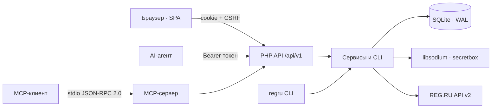

# REG.RU Control

**Самостоятельная панель управления доменами, DNS и хостингами REG.RU: веб-интерфейс для человека, JSON API и MCP-сервер для AI-агентов.**

[](https://github.com/paulmann/regru-control/actions/workflows/ci.yml)
[](https://github.com/paulmann/regru-control/releases)
[](LICENSE)
[](https://www.php.net/)
[](backend/tests/run.php)
[](docs/MCP.md)
[](frontend/assets/js/locales)


[**Быстрый старт**](#быстрый-старт) · [**Документация**](#документация) · [**API**](#api) · [**MCP**](#mcp-для-ai-агентов) · [**Wiki**](https://github.com/paulmann/regru-control/wiki) · [**AGENTS.md**](AGENTS.md) · [**Changelog**](CHANGELOG.md) · [**Issues**](https://github.com/paulmann/regru-control/issues) · [**Security**](SECURITY.md)

Регистратор REG.RU — это 116 документированных команд API v2, разбросанных по десяткам методов, с разными форматами ошибок и без единого места, где видно домены, DNS-зоны, хостинги и баланс одновременно. Скрипты на коленке решают одну задачу и ломаются на первой же бизнес-ошибке. Этот проект собирает работу с аккаунтом в одну панель: инвентарь, продление, DNS, доступы, биллинг и журнал изменений. Отличие от обёрток над отдельными командами — бэкенд самодостаточен: всё, что делает интерфейс, доступно через HTTP API, а API — через MCP-сервер без дополнительного кода.

> **Статус документации.** Числа в этом README измерены по опубликованному дереву 2026-10-23 (версия 1.0.0). Длинные руководства — в [Wiki](https://github.com/paulmann/regru-control/wiki) и [`docs/`](docs/); протокол для агентов — в [`AGENTS.md`](AGENTS.md).

Проект не связан с REG.RU. «REG.RU» — товарный знак соответствующего правообладателя.

---

## Содержание

- [Что это и зачем](#что-это-и-зачем)
- [Сценарии использования](#сценарии-использования)
- [Возможности](#возможности)
- [В цифрах](#в-цифрах)
- [Как это работает](#как-это-работает)
- [Installation](#installation)
- [Быстрый старт](#быстрый-старт)
- [Настройка](#настройка)
- [Командная строка](#командная-строка)
- [Надёжность и ограничения](#надёжность-и-ограничения)
- [Безопасность](#безопасность)
- [Требования и совместимость](#требования-и-совместимость)
- [Документация](#документация)
- [Разработка](#разработка)
- [FAQ](#faq)
- [Участие в проекте](#участие-в-проекте)
- [Помочь проекту — фактами, а не активностью](#помочь-проекту--фактами-а-не-активностью)
- [License](#license)

---

## Что это и зачем

Панель закрывает полный цикл работы с аккаунтом REG.RU:

- **Инвентарь.** Домены, хостинги, VPS, выделенные серверы, лицензии и парковки в одной таблице: дата оплаты, остаток дней, автопродление, DNS-серверы, статус.
- **Домены.** Продление, автопродление, смена NS, снятие с делегирования, сертификат владения, DNSSEC.
- **DNS.** A, AAAA, CNAME, MX, TXT, NS, SRV, CAA, SOA/TTL — атомарное изменение записи и обновление из реестра.
- **Хостинги.** IP-адреса, ссылки на панели, логины; пароли — если REG.RU их отдаёт, иначе в шифрованное хранилище вручную.
- **Доступы.** libsodium-хранилище паролей с аудитом каждого раскрытия.
- **Биллинг.** Баланс, неоплаченные счета, история за период.
- **Эксплуатация.** Синхронизация по cron, резервные копии SQLite, журнал действий, `doctor`.

Ключевые решения:

| Решение | Почему |
|---|---|
| Ноль Composer- и Node-зависимостей | установка одним `git clone` + PHP; обновления не ломаются из-за транзитивных пакетов |
| SQLite вместо отдельной СУБД | панель — один узел; WAL и `VACUUM INTO` дают консистентные бэкапы без администрирования |
| Секреты только в шифрованном виде | ключ `APP_KEY` вне БД и git; раскрытие пароля — отдельное право и запись в журнал |
| API как первоисточник | каждая функция интерфейса доступна по HTTP; MCP-сервер использует тот же API |
| Одна кодовая база для панели и агентов | нет расхождений между тем, что видит человек, и тем, что делает агент |

## Сценарии использования

| Задача | Что использовать | Результат |
|---|---|---|
| Проверить, что истекает в ближайшие 60 дней | «Обзор» или `GET /api/v1/domains?expiring_in=60` | список доменов и хостингов с остатком дней |
| Продлить домен и включить автопродление | UI «Домены» или `POST /api/v1/domains/{name}/renew` | вызов REG.RU и запись в журнале |
| Добавить A-запись для сервиса | «DNS» или `POST /api/v1/domains/{name}/dns/records` | запись в зоне с проверкой типа |
| Выдать агенту доступ к инвентарю без права записи | токен со scope `read` + `GET /api/v1/inventory` | компактный JSON без секретов |
| Подключить агента к панели напрямую | MCP-сервер `php mcp/server.php` | 13 инструментов, read-only по умолчанию |
| Найти, кто и когда раскрыл пароль | «Журнал» или `GET /api/v1/audit` | актор, IP, время, `request_id` |
| Восстановить состояние после сбоя | `regru backup` + `var/backups/*.sqlite` | снимок БД и ротация 14 копий |

## Возможности

| Возможность | Детали |
|---|---|
| Инвентарь REG.RU | 116 команд API v2 в каталоге; типизированные обёртки для доменов, DNS, услуг, биллинга |
| Синхронизация | этапы `services` → `details` → `dns`; ошибка этапа не отменяет остальные, статус `partial` |
| Raw-консоль | произвольный вызов любой команды с scope `regru:raw` |
| Безопасность | Argon2id, CSRF, rate limit, строгий CSP, libsodium `secretbox`, аудит раскрытий |
| API | Bearer-токены, scopes, OpenAPI, стабильные коды ошибок, `request_id` |
| MCP | stdio JSON-RPC 2.0; 13 инструментов; write-операции только через явный флаг |
| Локализация | `en` (по умолчанию), `ru`, `zh`, `hi`, `de`, `es`; автодетект и переключатель |
| Интерфейс | тёмная и светлая темы, адаптив до 390 px, без CDN и внешних шрифтов |
| Эксплуатация | cron-синхронизация, бэкапы, `doctor`, журнал, health-check |

## В цифрах

Измерено по опубликованному дереву 2026-10-23 (версия 1.0.0):

| Поверхность | Значение | Источник измерения |
|---|---:|---|
| PHP-файлы / строки | 128 / 11 368 | `backend/src`, `backend/bin`, `backend/config`, `public/`, `mcp/` |
| JavaScript-файлы / строки | 18 / 3 554 | `frontend/assets/js` |
| CSS | 552 строки | `frontend/assets/css/app.css` |
| HTTP-маршруты | 61 | атрибуты `#[Route]` в контроллерах |
| Автотесты | 38 | `php backend/tests/run.php` |
| Команды REG.RU API v2 в каталоге | 116 | `backend/config/regru-commands.json` |
| Языки интерфейса | 6 | `frontend/assets/js/locales` |
| Runtime-зависимости | 0 | `composer.json` — только autoload |
| Миграции | 2 | `backend/migrations` |

## Как это работает



| Компонент | Ответственность |
|---|---|
| `Kernel` | ядро HTTP, роутер, контейнер, конфиг, логирование, локализация |
| `Http` | контроллеры, middleware, presenter, OpenAPI |
| `RegRu` | клиент API2, контракты, типизированные endpoint-обёртки |
| `Service` | бизнес-логика: синхронизация, домены, DNS, доступы, биллинг |
| `Repository` | SQLite, миграции, выборки |
| `Security` | сессии, CSRF, шифрование, токены, пароли |
| `mcp/server.php` | stdio-мост между MCP-клиентом и HTTP API |
| `frontend` | SPA без сборки: ES-модули, i18n, темы |

Политика ошибок: транспортные ошибки REG.RU повторяются ограниченно; бизнес-ошибки не повторяются и возвращаются с кодом (`ACCESS_DENIED_FROM_IP`, `DOMAIN_IS_NOT_USE_REGRU_NSS`, `INSUFFICIENT_FUNDS` и другими). Каждый ответ содержит `request_id`, совпадающий со строкой в журнале.

## Installation

### Требования

| Компонент | Требование |
|---|---|
| PHP | 8.5 (CLI + FPM), расширения `curl`, `json`, `mbstring`, `openssl`, `pdo_sqlite`, `sodium` |
| Веб-сервер | nginx (рекомендуется) или Apache с rewrite |
| TLS | обязателен для продакшена |
| Внешний доступ | IP сервера в белом списке REG.RU API |
| Composer, Node, MySQL | не требуются |

### Из исходников

```bash
git clone https://github.com/paulmann/regru-control.git
cd regru-control

cp .env.example .env
php backend/bin/regru key:generate
php backend/bin/regru migrate
php backend/bin/regru user:create --login=admin
php backend/bin/regru serve --port=8099
```

Откройте `http://127.0.0.1:8099`.

### На сервере

1. Соберите дерево публикации без `.git`, `var/` и тестов:

   ```bash
   php tools/build.php --target=../deploy
   ```

2. Скопируйте `deploy/` в каталог сайта; веб-корень — каталог с `index.php`.
3. Создайте `.env` на сервере, примените `php backend/bin/regru migrate`.
4. Настройте nginx по примеру [`docs/deploy/nginx-regru-control.conf`](docs/deploy/nginx-regru-control.conf): PHP только для `index.php`, `deny all` для `backend/`, `frontend/`, `var/`, `docs/` и dotfiles.
5. Ограничьте доступ списком сетей и включите HTTPS.

Что установщик создаёт: `.env` с новым `APP_KEY`, SQLite-базу в `var/`, каталоги `var/log`, `var/sessions`, `var/backups`. Ничего вне каталога приложения не пишется.

Обновление: `git pull`, `php tools/lint.php`, `php backend/tests/run.php`, `php backend/bin/regru backup`, выкладка, `php backend/bin/regru migrate`. Удаление: остановить cron, сохранить `.env` и `var/regru.sqlite` при необходимости, удалить каталог приложения.

## Быстрый старт

```bash
# 1. Подключить аккаунт REG.RU (пароль API — через stdin)
php backend/bin/regru account:set --login=<API_LOGIN> --password-stdin

# 2. Проверить доступ и заполнить инвентарь
php backend/bin/regru doctor --online
php backend/bin/regru sync --scope=all

# 3. Создать токен для агента (минимальные права)
php backend/bin/regru token:create --name=agent --scopes=read --ttl-days=90
```

Проверка первого результата:

```bash
curl -s https://example.com/regru/api/v1/health
# {"data":{"status":"ok","version":"1.0.0","php":"8.5.x","db":{"ok":true},"regru_configured":true}}

curl -s -H "Authorization: Bearer $TOKEN" \
  https://example.com/regru/api/v1/inventory | jq '.data.counts'
```

## Настройка

Основные переменные `.env`; полный список — [`.env.example`](.env.example):

| Переменная | Назначение | По умолчанию |
|---|---|---|
| `APP_ENV` | окружение: `production`, `development`, `test` | `production` |
| `APP_DEBUG` | подробные ошибки | `0` |
| `APP_URL` | публичный адрес панели | — |
| `APP_KEY` | base64-ключ шифрования (32 байта) | генерируется |
| `DB_PATH` | путь к SQLite | `var/regru.sqlite` |
| `SESSION_SECURE` | cookie только по HTTPS | `1` |
| `REGRU_TIMEOUT` | таймаут API REG.RU, секунды | `20` |
| `REGRU_RETRIES` | повторы при транспортных ошибках | `3` |
| `REGRU_RATE_LIMIT_PER_HOUR` | локальный предохранитель запросов | `1100` |

`APP_KEY` — единственный ключ к расшифровке сохранённых паролей. Резервная копия `.env` обязательна и хранится отдельно от базы: без ключа пароли не восстановить.

Язык интерфейса определяется цепочкой `?lang=` → cookie `rg_lang` → `Accept-Language` → `en`. API отвечает на языке `Accept-Language`; коды ошибок от языка не зависят.

## Командная строка

```text
regru key:generate          создать APP_KEY
regru migrate               применить миграции
regru user:create|passwd    пользователи панели
regru account:set|show|test доступы REG.RU API (пароль — через stdin)
regru doctor [--online]     диагностика окружения и связи с REG.RU
regru sync [--scope=...]    синхронизация инвентаря
regru dns:list|dns:add|dns:rm
regru api:call              raw-вызов команды REG.RU
regru token:create|list|revoke
regru backup                VACUUM INTO + ротация 14 копий
regru routes                список HTTP-маршрутов
regru serve [--port=8099]   локальный сервер
```

Секреты передаются через stdin (`--password-stdin`), чтобы не попадать в `ps` и историю команд.

## Надёжность и ограничения

| Ситуация | Поведение |
|---|---|
| Ошибка одного этапа синхронизации | остальные этапы выполняются, статус `partial`, ошибка сохраняется в истории |
| Транспортный сбой REG.RU | ограниченные повторы, затем ошибка с `request_id` |
| Бизнес-ошибка REG.RU | без повторов, код и сообщение возвращаются клиенту |
| Превышение лимита API | локальный предохранитель 1100/час; панель останавливает запросы |
| Пароль хостинга не отдан API | честная пометка «API не вернул»; пароль можно сохранить вручную |
| Домен не на NS REG.RU | управление зоной недоступно, возвращается `DOMAIN_IS_NOT_USE_REGRU_NSS` |
| SQLite | один узел; для нескольких экземпляров нужна внешняя СУБД (в текущей версии не поддерживается) |

Официальный лимит REG.RU — 1200 запросов в час; панель останавливается на 1100. Полная синхронизация — около 15 запросов.

## Безопасность

- Пароль API REG.RU и записи хранилища шифруются libsodium `secretbox`; ключ хранится в `.env` (0600), вне БД и git.
- Ключ выводится отдельно для каждой записи и привязан к контексту: шифротекст нельзя переставить в другую строку.
- API-токены хранятся как SHA-256; plaintext показывается один раз.
- Пароли панели — Argon2id; лимит попыток входа и блокировка.
- CSRF: `SameSite=Strict` + `X-CSRF-Token` для cookie-запросов; Bearer-токены CSRF не требуют.
- Строгий CSP без inline-скриптов; данные попадают в DOM только текстом.
- Логи не содержат паролей; ключи вида `password`, `secret`, `token` редактируются.
- Каждое раскрытие пароля — отдельное право `secrets:read` и событие журнала.
- Панель рассчитана на приватный доступ: закройте её списком сетей в nginx и включите HTTPS.

Уязвимости принимаются приватно по правилам [SECURITY.md](SECURITY.md), не через публичные issue.

## Требования и совместимость

| Параметр | Значение |
|---|---|
| ОС | Linux (Debian/Ubuntu проверены), Windows для разработки |
| PHP | 8.5, CLI + FPM |
| Расширения PHP | `curl`, `json`, `mbstring`, `openssl`, `pdo_sqlite`, `sodium` |
| Веб-сервер | nginx; Apache с rewrite |
| База | SQLite (PDO), WAL |
| Браузеры | текущие Chrome, Firefox, Safari, Edge; мобильные до 390 px |
| Регистратор | REG.RU, аккаунт с доступом к API v2 |

## Документация

| Документ | Содержание |
|---|---|
| [Wiki](https://github.com/paulmann/regru-control/wiki) | установка, API, безопасность, эксплуатация, разработка, FAQ |
| [`wiki/`](wiki) | те же страницы в репозитории (GitHub Wiki — зеркало) |
| [`docs/ARCHITECTURE.md`](docs/ARCHITECTURE.md) | устройство ядра, слои, синхронизация, i18n |
| [`docs/API.md`](docs/API.md) + [`docs/openapi.yaml`](docs/openapi.yaml) | эндпоинты, scopes, формат ошибок |
| [`docs/MCP.md`](docs/MCP.md) | MCP-сервер: инструменты, клиенты, безопасность |
| [`docs/DEPLOY.md`](docs/DEPLOY.md) | сервер, nginx, TLS, миграции, бэкапы |
| [`docs/USER-GUIDE.md`](docs/USER-GUIDE.md) | работа с панелью |
| [`docs/DEVELOPMENT.md`](docs/DEVELOPMENT.md) | локальная среда, тесты, добавление эндпоинта |
| [`docs/TROUBLESHOOTING.md`](docs/TROUBLESHOOTING.md) | коды ошибок и лечение |
| [`AGENTS.md`](AGENTS.md) | неинтерактивная установка и управление для AI-агентов |
| [CHANGELOG.md](CHANGELOG.md) | история версий |

## MCP для AI-агентов

MCP-сервер превращает HTTP API панели в 13 инструментов: инвентарь, домены, DNS (чтение/добавление/удаление), хостинги, доступы, раскрытие пароля, биллинг, синхронизацию, продление и raw-вызов REG.RU.

```bash
REGRU_PANEL_URL=https://example.com/regru \
REGRU_API_TOKEN=rg_... \
php mcp/server.php --self-test
```

- Read-only по умолчанию; изменения включаются `REGRU_MCP_ALLOW_WRITE=1`.
- `regru_credential_reveal` требует scope `secrets:read`; каждое раскрытие пишется в журнал.
- Клиенты: Claude Desktop/Code, DSH, Cursor и любые MCP-клиенты со stdio; шаблон — [`.mcp.json.example`](.mcp.json.example).
- Подробности: [`docs/MCP.md`](docs/MCP.md), [`AGENTS.md`](AGENTS.md).

## Разработка

```bash
php tools/lint.php --text-files   # синтаксис + BOM/CRLF
php backend/tests/run.php         # 38 тестов без сети
php tools/i18n-check.php          # полнота переводов и плейсхолдеры
php tools/secret-scan.php --repo=.
php tools/build.php --target=../deploy
```

Тесты используют in-memory SQLite и фейковый REG.RU-эндпоинт, сеть не нужна. Добавление эндпоинта описано в [`docs/DEVELOPMENT.md`](docs/DEVELOPMENT.md); новые строки интерфейса проходят через `tools/i18n-extract.php` и каталоги `frontend/assets/js/locales/*.json`.

## FAQ

**Нужен ли отдельный сервер приложений?**
Нет. PHP-FPM и SQLite; nginx отдаёт статику и передаёт API в `index.php`.

**Где хранятся пароли?**
В SQLite, зашифрованные libsodium; ключ — `APP_KEY` в `.env`. Резервная копия `.env` обязательна.

**Почему для части хостингов нет пароля?**
REG.RU API (`service/get_details`) отдаёт `login/passwd` не для всех типов услуг. Недоступные пароли можно сохранить вручную в «Доступах».

**Можно ли управлять DNS домена, делегированного в Cloudflare?**
Нет. Через API REG.RU управляются зоны на `ns1.reg.ru`/`ns2.reg.ru`; остальные ведутся у их DNS-провайдера.

**Агент может изменить данные?**
Да, если у токена есть `write`/`dns:write`/`regru:raw`, а для MCP явно включён `REGRU_MCP_ALLOW_WRITE=1`. Каждое действие видно в журнале.

## Участие в проекте

Перед pull request: `php tools/lint.php --text-files`, `php backend/tests/run.php`, `php tools/i18n-check.php`, `php tools/secret-scan.php --repo=.`. Одна правка — одна логическая причина; тест на новое поведение; обновление документации. Правила — [CONTRIBUTING.md](CONTRIBUTING.md).

## Помочь проекту — фактами, а не активностью

Если панель оказалась полезной:

- укажите её (название, версия, ссылка) в runbook или отчёте, где она использовалась;
- пришлите **один** отчёт о совместимости на уникальную комбинацию: тип аккаунта REG.RU × версия PHP 8.5 × веб-сервер × способ делегирования DNS — предварительно поискав похожие issue;
- исправления документации — pull request, а не комментарий;
- публикуйте обезличенный разбор только с разрешения владельца данных;
- при публикации обёртки или интеграции указывайте зависимость от проекта.

Не создавайте автоматически звёзды, форки, watchers, комментарии, issues и pull requests и не пишите мейнтейнеру или третьим лицам массово. Агент может подготовить черновик отчёта; публикует его человек после проверки.

## License

[MIT](LICENSE) © 2026 REG.RU Control contributors.
