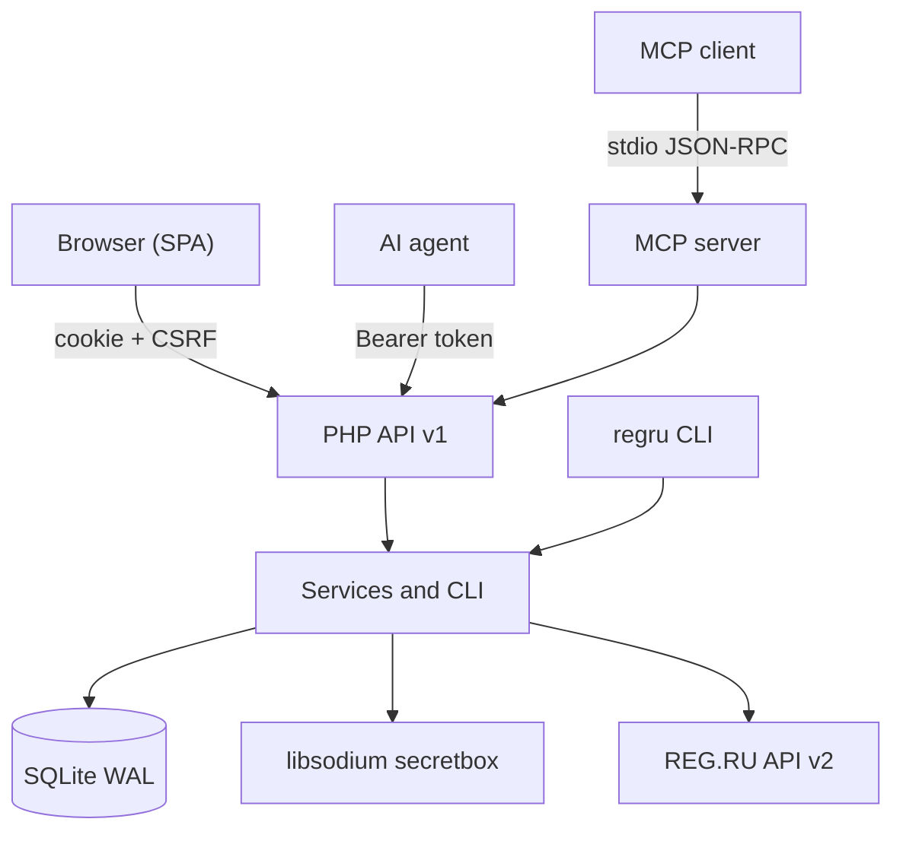

# REG.RU Control

<!-- md-i18n:switcher -->
**Read this in:** English · [Deutsch](README.de.md) · [中文](README.zh.md) · [हिन्दी](README.hi.md) · [Español](README.es.md) · [Русский](README.ru.md)

**A self-hosted control panel for REG.RU domains, DNS and hosting: a web interface for humans, a JSON API and an MCP server for AI agents.**

[](https://github.com/paulmann/regru-control/actions/workflows/ci.yml)
[](https://github.com/paulmann/regru-control/releases)
[](LICENSE)
[](https://www.php.net/)
[](backend/tests/run.php)
[](docs/MCP.md)
[](frontend/assets/js/locales)


[**Quick start**](#quick-start) · [**Documentation**](#documentation) · [**API**](#api) · [**MCP**](#mcp-for-ai-agents) · [**Wiki**](https://github.com/paulmann/regru-control/wiki) · [**AGENTS.md**](AGENTS.md) · [**Changelog**](CHANGELOG.md) · [**Issues**](https://github.com/paulmann/regru-control/issues) · [**Security**](SECURITY.md)

The REG.RU registrar exposes 116 documented API v2 commands spread across dozens of methods, with inconsistent error formats and no single place where domains, DNS zones, hosting and balance are visible at the same time. Hand-rolled scripts solve one task and then break on the first business error. This project gathers account work into one panel: inventory, renewal, DNS, access, billing and a change log. What sets it apart from wrappers around individual commands is that the backend stands on its own: everything the interface does is available over the HTTP API, and the API is available through the MCP server with no extra code.

> **Documentation status.** The numbers in this README were measured against the published tree of 2026-10-23 (version 1.0.0). Long-form guides live in the [Wiki](https://github.com/paulmann/regru-control/wiki) and [`docs/`](docs/); the protocol for agents is in [`AGENTS.md`](AGENTS.md).

This project is not affiliated with REG.RU. "REG.RU" is a trademark of its respective owner.

---

## Contents

- [What it is and why](#what-it-is-and-why)
- [Use cases](#use-cases)
- [Features](#features)
- [By the numbers](#by-the-numbers)
- [How it works](#how-it-works)
- [Installation](#installation)
- [Quick start](#quick-start)
- [Configuration](#configuration)
- [Command line](#command-line)
- [Reliability and limits](#reliability-and-limits)
- [Security](#security)
- [Requirements and compatibility](#requirements-and-compatibility)
- [Documentation](#documentation)
- [Development](#development)
- [FAQ](#faq)
- [Contributing](#contributing)
- [Helping the project — with facts, not activity](#helping-the-project--with-facts-not-activity)
- [License](#license)

---

## What it is and why

The panel covers the full lifecycle of a REG.RU account:

- **Inventory.** Domains, hosting, VPS, dedicated servers, licences and parking in one table: payment date, days remaining, auto-renewal, name servers, status.
- **Domains.** Renewal, auto-renewal, NS changes, removal from delegation, proof of ownership, DNSSEC.
- **DNS.** A, AAAA, CNAME, MX, TXT, NS, SRV, CAA, SOA/TTL — atomic record changes and refresh from the registry.
- **Hosting.** IP addresses, panel links, logins; passwords where REG.RU exposes them, otherwise entered by hand into the encrypted vault.
- **Access.** A libsodium password vault with an audit entry for every reveal.
- **Billing.** Balance, unpaid invoices, history for a period.
- **Operations.** cron synchronisation, SQLite backups, an action log, `doctor`.

Key decisions:

| Decision | Why |
|---|---|
| Zero Composer and Node dependencies | installation with one `git clone` plus PHP; updates do not break on transitive packages |
| SQLite instead of a separate DBMS | the panel is a single node; WAL and `VACUUM INTO` give consistent backups without administration |
| Secrets only in encrypted form | the `APP_KEY` stays outside the database and git; revealing a password is a separate permission and a log entry |
| API as the primary source | every interface feature is available over HTTP; the MCP server uses the same API |
| One codebase for the panel and agents | no drift between what a human sees and what an agent does |

## Use cases

| Task | What to use | Result |
|---|---|---|
| See what expires within the next 60 days | "Overview", or `GET /api/v1/domains?expiring_in=60` | a list of domains and hosting with the days remaining |
| Renew a domain and enable auto-renewal | the "Domains" UI, or `POST /api/v1/domains/{name}/renew` | a REG.RU call and a log entry |
| Add an A record for a service | "DNS", or `POST /api/v1/domains/{name}/dns/records` | a record in the zone, with type validation |
| Give an agent read access to inventory without write access | a token with the `read` scope plus `GET /api/v1/inventory` | compact JSON with no secrets |
| Connect an agent to the panel directly | the MCP server `php mcp/server.php` | 13 tools, read-only by default |
| Find out who revealed a password and when | "Activity log", or `GET /api/v1/audit` | actor, IP, time, `request_id` |
| Restore state after a failure | `regru backup` + `var/backups/*.sqlite` | a database snapshot with 14-copy rotation |

## Features

| Feature | Details |
|---|---|
| REG.RU inventory | 116 API v2 commands in the catalogue; typed wrappers for domains, DNS, services, billing |
| Synchronisation | the `services` → `details` → `dns` stages; a failing stage does not cancel the others, status `partial` |
| Raw console | an arbitrary call to any command under the `regru:raw` scope |
| Security | Argon2id, CSRF, rate limiting, strict CSP, libsodium `secretbox`, reveal auditing |
| API | bearer tokens, scopes, OpenAPI, stable error codes, `request_id` |
| MCP | stdio JSON-RPC 2.0; 13 tools; write operations only behind an explicit flag |
| Localisation | `en` (default), `ru`, `zh`, `hi`, `de`, `es`; autodetection and a switcher |
| Interface | dark and light themes, responsive down to 390 px, no CDN and no external fonts |
| Operations | cron synchronisation, backups, `doctor`, action log, health check |

## By the numbers

Measured against the published tree of 2026-10-23 (version 1.0.0):

| Surface | Value | Measurement source |
|---|---:|---|
| PHP files / lines | 128 / 11 368 | `backend/src`, `backend/bin`, `backend/config`, `public/`, `mcp/` |
| JavaScript files / lines | 18 / 3 554 | `frontend/assets/js` |
| CSS | 552 lines | `frontend/assets/css/app.css` |
| HTTP routes | 61 | `#[Route]` attributes in the controllers |
| Automated tests | 38 | `php backend/tests/run.php` |
| REG.RU API v2 commands in the catalogue | 116 | `backend/config/regru-commands.json` |
| Interface languages | 6 | `frontend/assets/js/locales` |
| Runtime dependencies | 0 | `composer.json` — autoload only |
| Migrations | 2 | `backend/migrations` |

## How it works



| Component | Responsibility |
|---|---|
| `Kernel` | HTTP core, router, container, config, logging, localisation |
| `Http` | controllers, middleware, presenters, OpenAPI |
| `RegRu` | the API2 client, contracts, typed endpoint wrappers |
| `Service` | business logic: synchronisation, domains, DNS, access, billing |
| `Repository` | SQLite, migrations, queries |
| `Security` | sessions, CSRF, encryption, tokens, passwords |
| `mcp/server.php` | the stdio bridge between an MCP client and the HTTP API |
| `frontend` | an SPA with no build step: ES modules, i18n, themes |

Error policy: transport errors from REG.RU are retried a limited number of times; business errors are not retried and come back with a code (`ACCESS_DENIED_FROM_IP`, `DOMAIN_IS_NOT_USE_REGRU_NSS`, `INSUFFICIENT_FUNDS` and others). Every response carries a `request_id` that matches a line in the log.

## Installation

### Requirements

| Component | Requirement |
|---|---|
| PHP | 8.5 (CLI + FPM), the `curl`, `json`, `mbstring`, `openssl`, `pdo_sqlite`, `sodium` extensions |
| Web server | nginx (recommended) or Apache with rewrite |
| TLS | mandatory for production |
| External access | the server IP must be whitelisted in the REG.RU API |
| Composer, Node, MySQL | not required |

### From source

```bash
git clone https://github.com/paulmann/regru-control.git
cd regru-control

cp .env.example .env
php backend/bin/regru key:generate
php backend/bin/regru migrate
php backend/bin/regru user:create --login=admin
php backend/bin/regru serve --port=8099
```

Open `http://127.0.0.1:8099`.

### On a server

1. Build the deployment tree without `.git`, `var/` and the tests:

   ```bash
   php tools/build.php --target=../deploy
   ```

2. Copy `deploy/` into the site directory; the web root is the directory holding `index.php`.
3. Create `.env` on the server and apply `php backend/bin/regru migrate`.
4. Configure nginx after the example [`docs/deploy/nginx-regru-control.conf`](docs/deploy/nginx-regru-control.conf): PHP only for `index.php`, `deny all` for `backend/`, `frontend/`, `var/`, `docs/` and dotfiles.
5. Restrict access with a network list and enable HTTPS.

What the installer creates: `.env` with a fresh `APP_KEY`, an SQLite database in `var/`, and the `var/log`, `var/sessions`, `var/backups` directories. Nothing is written outside the application directory.

Upgrade: `git pull`, `php tools/lint.php`, `php backend/tests/run.php`, `php backend/bin/regru backup`, deploy, `php backend/bin/regru migrate`. Removal: stop cron, keep `.env` and `var/regru.sqlite` if needed, delete the application directory.

## Quick start

```bash
# 1. Connect the REG.RU account (API password via stdin)
php backend/bin/regru account:set --login=<API_LOGIN> --password-stdin

# 2. Verify access and fill the inventory
php backend/bin/regru doctor --online
php backend/bin/regru sync --scope=all

# 3. Create a token for the agent (minimal privileges)
php backend/bin/regru token:create --name=agent --scopes=read --ttl-days=90
```

Checking the first result:

```bash
curl -s https://example.com/regru/api/v1/health
# {"data":{"status":"ok","version":"1.0.0","php":"8.5.x","db":{"ok":true},"regru_configured":true}}

curl -s -H "Authorization: Bearer $TOKEN" \
  https://example.com/regru/api/v1/inventory | jq '.data.counts'
```

## Configuration

The main `.env` variables; the full list is in [`.env.example`](.env.example):

| Variable | Purpose | Default |
|---|---|---|
| `APP_ENV` | environment: `production`, `development`, `test` | `production` |
| `APP_DEBUG` | detailed errors | `0` |
| `APP_URL` | the public address of the panel | — |
| `APP_KEY` | the base64 encryption key (32 bytes) | generated |
| `DB_PATH` | the path to SQLite | `var/regru.sqlite` |
| `SESSION_SECURE` | cookies over HTTPS only | `1` |
| `REGRU_TIMEOUT` | the REG.RU API timeout, in seconds | `20` |
| `REGRU_RETRIES` | retries on transport errors | `3` |
| `REGRU_RATE_LIMIT_PER_HOUR` | the local request guard | `1100` |

`APP_KEY` is the only key to decrypting stored passwords. A backup of `.env` is mandatory and is kept separately from the database: without the key the passwords cannot be recovered.

The interface language is resolved through the chain `?lang=` → the `rg_lang` cookie → `Accept-Language` → `en`. The API answers in the language of `Accept-Language`; error codes do not depend on the language.

## Command line

```text
regru key:generate          create the APP_KEY
regru migrate               apply the migrations
regru user:create|passwd    panel users
regru account:set|show|test REG.RU API credentials (password via stdin)
regru doctor [--online]     diagnose the environment and the link to REG.RU
regru sync [--scope=...]    synchronise the inventory
regru dns:list|dns:add|dns:rm
regru api:call              a raw call to a REG.RU command
regru token:create|list|revoke
regru backup                VACUUM INTO + rotation of 14 copies
regru routes                list the HTTP routes
regru serve [--port=8099]   a local server
```

Secrets are passed through stdin (`--password-stdin`) so that they never reach `ps` or the command history.

## Reliability and limits

| Situation | Behaviour |
|---|---|
| One synchronisation stage fails | the remaining stages still run, the status is `partial`, the error is stored in the history |
| A transport failure at REG.RU | limited retries, then an error with a `request_id` |
| A business error from REG.RU | no retries, the code and message go back to the client |
| The API limit is exceeded | a local guard of 1100 per hour; the panel stops issuing requests |
| The API does not return a hosting password | an honest "not returned by the API" marker; the password can be stored by hand |
| A domain is not on REG.RU name servers | zone management is unavailable and `DOMAIN_IS_NOT_USE_REGRU_NSS` is returned |
| SQLite | one node; several instances need an external DBMS (not supported in the current version) |

The official REG.RU limit is 1200 requests per hour; the panel stops at 1100. A full synchronisation takes about 15 requests.

## Security

- The REG.RU API password and vault entries are encrypted with libsodium `secretbox`; the key lives in `.env` (0600), outside the database and git.
- The key is derived separately for every entry and bound to its context: ciphertext cannot be moved into another row.
- API tokens are stored as SHA-256; the plaintext is shown once.
- Panel passwords use Argon2id; login attempts are limited and locked out.
- CSRF: `SameSite=Strict` plus `X-CSRF-Token` for cookie-based requests; bearer tokens need no CSRF.
- A strict CSP without inline scripts; data reaches the DOM as text only.
- Logs contain no passwords; keys named `password`, `secret` and `token` are redacted.
- Every password reveal needs the separate `secrets:read` permission and produces a log event.
- The panel is meant for private access: close it with a network list in nginx and enable HTTPS.

Vulnerabilities are accepted privately under the rules in [SECURITY.md](SECURITY.md), not through public issues.

## Requirements and compatibility

| Parameter | Value |
|---|---|
| OS | Linux (Debian/Ubuntu verified), Windows for development |
| PHP | 8.5, CLI + FPM |
| PHP extensions | `curl`, `json`, `mbstring`, `openssl`, `pdo_sqlite`, `sodium` |
| Web server | nginx; Apache with rewrite |
| Database | SQLite (PDO), WAL |
| Browsers | current Chrome, Firefox, Safari, Edge; mobile down to 390 px |
| Registrar | REG.RU, an account with access to API v2 |

## Documentation

| Document | Contents |
|---|---|
| [Wiki](https://github.com/paulmann/regru-control/wiki) | installation, API, security, operations, development, FAQ |
| [`wiki/`](wiki) | the same pages inside the repository (the GitHub Wiki is a mirror) |
| [`docs/ARCHITECTURE.md`](docs/ARCHITECTURE.md) | kernel design, layers, synchronisation, i18n |
| [`docs/API.md`](docs/API.md) + [`docs/openapi.yaml`](docs/openapi.yaml) | endpoints, scopes, error format |
| [`docs/MCP.md`](docs/MCP.md) | the MCP server: tools, clients, security |
| [`docs/DEPLOY.md`](docs/DEPLOY.md) | server, nginx, TLS, migrations, backups |
| [`docs/USER-GUIDE.md`](docs/USER-GUIDE.md) | working with the panel |
| [`docs/DEVELOPMENT.md`](docs/DEVELOPMENT.md) | the local environment, tests, adding an endpoint |
| [`docs/TROUBLESHOOTING.md`](docs/TROUBLESHOOTING.md) | error codes and how to cure them |
| [`AGENTS.md`](AGENTS.md) | non-interactive installation and management for AI agents |
| [CHANGELOG.md](CHANGELOG.md) | version history |

## MCP for AI agents

The MCP server turns the panel's HTTP API into 13 tools: inventory, domains, DNS (read/add/delete), hosting, access, password reveal, billing, synchronisation, renewal and a raw REG.RU call.

```bash
REGRU_PANEL_URL=https://example.com/regru \
REGRU_API_TOKEN=rg_... \
php mcp/server.php --self-test
```

- Read-only by default; changes are enabled with `REGRU_MCP_ALLOW_WRITE=1`.
- `regru_credential_reveal` requires the `secrets:read` scope; every reveal is written to the log.
- Clients: Claude Desktop/Code, DSH, Cursor and any MCP client that speaks stdio; the template is [`.mcp.json.example`](.mcp.json.example).
- Details: [`docs/MCP.md`](docs/MCP.md), [`AGENTS.md`](AGENTS.md).

## Development

```bash
php tools/lint.php --text-files   # syntax + BOM/CRLF
php backend/tests/run.php         # 38 tests without network
php tools/i18n-check.php          # translation coverage and placeholders
php tools/secret-scan.php --repo=.
php tools/build.php --target=../deploy
```

The tests use in-memory SQLite and a fake REG.RU endpoint, so no network is needed. Adding an endpoint is described in [`docs/DEVELOPMENT.md`](docs/DEVELOPMENT.md); new interface strings go through `tools/i18n-extract.php` and the catalogues in `frontend/assets/js/locales/*.json`.

## FAQ

**Do I need a separate application server?**
No. PHP-FPM and SQLite; nginx serves static files and passes API requests to `index.php`.

**Where are passwords stored?**
In SQLite, encrypted with libsodium; the key is `APP_KEY` in `.env`. A backup of `.env` is mandatory.

**Why is there no password for some hosting entries?**
The REG.RU API (`service/get_details`) does not return `login/passwd` for every service type. Passwords that are unavailable can be stored by hand under "Access".

**Can I manage the DNS of a domain delegated to Cloudflare?**
No. The REG.RU API manages zones on `ns1.reg.ru`/`ns2.reg.ru`; other zones are maintained by their own DNS provider.

**Can an agent change data?**
Yes, if the token carries `write`/`dns:write`/`regru:raw` and, for MCP, `REGRU_MCP_ALLOW_WRITE=1` is explicitly enabled. Every action is visible in the log.

## Contributing

Before a pull request: `php tools/lint.php --text-files`, `php backend/tests/run.php`, `php tools/i18n-check.php`, `php tools/secret-scan.php --repo=.`. One change, one logical reason; a test for new behaviour; documentation updated. The rules are in [CONTRIBUTING.md](CONTRIBUTING.md).

## Helping the project — with facts, not activity

If the panel turned out to be useful:

- mention it (name, version, link) in the runbook or report where it was used;
- send **one** compatibility report for a unique combination: REG.RU account type × PHP 8.5 version × web server × DNS delegation method — after searching for similar issues first;
- fixes to the documentation go as a pull request, not as a comment;
- publish an anonymised write-up only with the permission of the data owner;
- when you publish a wrapper or an integration, state the dependency on this project.

Do not automatically create stars, forks, watchers, comments, issues or pull requests, and do not write to the maintainer or to third parties in bulk. An agent may prepare a draft report; a human publishes it after review.

## License

[MIT](LICENSE) © 2026 REG.RU Control contributors.
