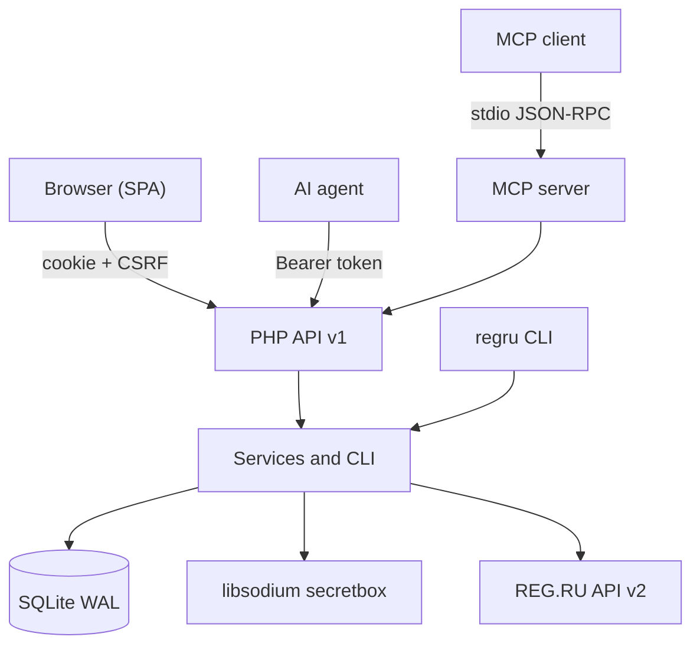

# REG.RU Control

<!-- md-i18n:switcher -->
**其他语言：** [English](README.md) · [Deutsch](README.de.md) · 中文 · [हिन्दी](README.hi.md) · [Español](README.es.md) · [Русский](README.ru.md)

**自托管的 REG.RU 域名、DNS 与主机控制面板：面向人的 Web 界面，面向 AI 智能体的 JSON API 与 MCP 服务器。**

[](https://github.com/paulmann/regru-control/actions/workflows/ci.yml)
[](https://github.com/paulmann/regru-control/releases)
[](LICENSE)
[](https://www.php.net/)
[](backend/tests/run.php)
[](docs/MCP.md)
[](frontend/assets/js/locales)


[**快速开始**](#快速开始) · [**文档**](#文档) · [**API**](#api) · [**MCP**](#面向-ai-智能体的-mcp) · [**Wiki**](https://github.com/paulmann/regru-control/wiki) · [**AGENTS.md**](AGENTS.md) · [**Changelog**](CHANGELOG.md) · [**Issues**](https://github.com/paulmann/regru-control/issues) · [**Security**](SECURITY.md)

REG.RU 注册商公开了 116 条 API v2 命令，散布在数十个方法里，错误格式各不相同，而且没有一个地方能同时看到域名、DNS 区域、主机与余额。手写的脚本只能解决一个任务，遇到第一个业务错误就会崩。本项目把账户上的工作收拢到一个面板：清点、续费、DNS、权限、账单与变更日志。它与单条命令封装脚本的区别在于后端自成体系：界面能做的每一件事都能通过 HTTP API 完成，而 API 又能通过 MCP 服务器直接使用，不需要额外写代码。

> **文档状态。** 本 README 中的数字按 2026-10-23 的已发布代码树（版本 1.0.0）实测。长篇指南在 [Wiki](https://github.com/paulmann/regru-control/wiki) 与 [`docs/`](docs/) 里；面向智能体的协议在 [`AGENTS.md`](AGENTS.md)。

本项目与 REG.RU 没有隶属关系。「REG.RU」是其各自所有者的商标。

---

## 目录

- [这是什么以及为什么需要](#这是什么以及为什么需要)
- [使用场景](#使用场景)
- [功能特性](#功能特性)
- [数字一览](#数字一览)
- [工作原理](#工作原理)
- [安装](#安装)
- [快速开始](#快速开始)
- [配置](#配置)
- [命令行](#命令行)
- [可靠性与限制](#可靠性与限制)
- [安全](#安全)
- [环境要求与兼容性](#环境要求与兼容性)
- [文档](#文档)
- [开发](#开发)
- [常见问题](#常见问题)
- [参与贡献](#参与贡献)
- [帮助项目 —— 用事实而不是活跃度](#帮助项目--用事实而不是活跃度)
- [许可证](#许可证)

---

## 这是什么以及为什么需要

面板覆盖 REG.RU 账户的完整生命周期：

- **清点。** 域名、主机、VPS、独立服务器、许可证与停放域名集中在一张表里：付款日期、剩余天数、自动续费、名称服务器、状态。
- **域名。** 续费、自动续费、修改 NS、取消委派、所有权验证、DNSSEC。
- **DNS。** A、AAAA、CNAME、MX、TXT、NS、SRV、CAA、SOA/TTL —— 记录原子化变更，并从注册局刷新。
- **主机。** IP 地址、面板链接、登录名；密码在 REG.RU 提供时自动取得，否则手工录入加密保管库。
- **权限。** 基于 libsodium 的密码保管库，每次查看都留下审计记录。
- **账单。** 余额、未付发票、指定区间的历史。
- **运维。** cron 同步、SQLite 备份、操作日志、`doctor`。

关键决策：

| 决策 | 理由 |
|---|---|
| 零 Composer 与 Node 依赖 | 一次 `git clone` 加 PHP 即可安装；更新不会因传递依赖而中断 |
| 用 SQLite 而不另设数据库 | 面板只有一个节点；WAL 与 `VACUUM INTO` 无需运维即得到一致备份 |
| 密钥只以加密形式存在 | `APP_KEY` 存放在数据库与 git 之外；查看密码是单独权限，并写入日志 |
| 以 API 为唯一来源 | 界面的每个功能都能通过 HTTP 使用；MCP 服务器用的是同一套 API |
| 面板与智能体共用一套代码 | 人看到的行为与智能体执行的行为不会出现偏差 |

## 使用场景

| 任务 | 使用方式 | 结果 |
|---|---|---|
| 查看未来 60 天内到期的项 | 「概览」，或 `GET /api/v1/domains?expiring_in=60` | 域名与主机的清单，带剩余天数 |
| 续费域名并开启自动续费 | 「域名」界面，或 `POST /api/v1/domains/{name}/renew` | 一次 REG.RU 调用与一条日志记录 |
| 为某个服务添加 A 记录 | 「DNS」，或 `POST /api/v1/domains/{name}/dns/records` | 区域中多一条记录，并做类型校验 |
| 让智能体只读清点数据，不给写权限 | 带 `read` scope 的令牌加 `GET /api/v1/inventory` | 不含密钥的紧凑 JSON |
| 直接把智能体接到面板上 | MCP 服务器 `php mcp/server.php` | 13 个工具，默认只读 |
| 查出谁在何时查看了密码 | 「活动日志」，或 `GET /api/v1/audit` | 操作者、IP、时间、`request_id` |
| 故障后恢复状态 | `regru backup` 加 `var/backups/*.sqlite` | 数据库快照，保留 14 份副本轮转 |

## 功能特性

| 功能 | 细节 |
|---|---|
| REG.RU 清点 | 目录中收录 116 条 API v2 命令；域名、DNS、服务、账单都有类型化封装 |
| 同步 | `services` → `details` → `dns` 三个阶段；某一阶段失败不会取消其余阶段，状态为 `partial` |
| 原始控制台 | 在 `regru:raw` scope 下任意调用任何命令 |
| 安全 | Argon2id、CSRF、速率限制、严格 CSP、libsodium `secretbox`、查看审计 |
| API | Bearer 令牌、scope、OpenAPI、稳定的错误码、`request_id` |
| MCP | stdio JSON-RPC 2.0；13 个工具；写操作只在显式标志后开放 |
| 本地化 | `en`（默认）、`ru`、`zh`、`hi`、`de`、`es`；自动识别与切换器 |
| 界面 | 深色与浅色主题，响应式适配到 390 px，不使用 CDN 与外部字体 |
| 运维 | cron 同步、备份、`doctor`、操作日志、健康检查 |

## 数字一览

按 2026-10-23 的已发布代码树（版本 1.0.0）实测：

| 范围 | 数值 | 测量来源 |
|---|---:|---|
| PHP 文件 / 行数 | 128 / 11 368 | `backend/src`、`backend/bin`、`backend/config`、`public/`、`mcp/` |
| JavaScript 文件 / 行数 | 18 / 3 554 | `frontend/assets/js` |
| CSS | 552 行 | `frontend/assets/css/app.css` |
| HTTP 路由 | 61 | 控制器中的 `#[Route]` 属性 |
| 自动化测试 | 38 | `php backend/tests/run.php` |
| 目录中的 REG.RU API v2 命令 | 116 | `backend/config/regru-commands.json` |
| 界面语言 | 6 | `frontend/assets/js/locales` |
| 运行时依赖 | 0 | `composer.json` —— 仅 autoload |
| 迁移 | 2 | `backend/migrations` |

## 工作原理



| 组件 | 职责 |
|---|---|
| `Kernel` | HTTP 核心、路由、容器、配置、日志、本地化 |
| `Http` | 控制器、中间件、presenter、OpenAPI |
| `RegRu` | API2 客户端、契约、类型化端点封装 |
| `Service` | 业务逻辑：同步、域名、DNS、权限、账单 |
| `Repository` | SQLite、迁移、查询 |
| `Security` | 会话、CSRF、加密、令牌、密码 |
| `mcp/server.php` | MCP 客户端与 HTTP API 之间的 stdio 桥 |
| `frontend` | 无需构建的 SPA：ES 模块、i18n、主题 |

错误策略：REG.RU 的传输层错误有限次重试；业务错误不重试，而是带错误码返回（`ACCESS_DENIED_FROM_IP`、`DOMAIN_IS_NOT_USE_REGRU_NSS`、`INSUFFICIENT_FUNDS` 等）。每个响应都带 `request_id`，与日志中的一行对应。

## 安装

### 环境要求

| 组件 | 要求 |
|---|---|
| PHP | 8.5（CLI + FPM），`curl`、`json`、`mbstring`、`openssl`、`pdo_sqlite`、`sodium` 扩展 |
| Web 服务器 | nginx（推荐）或带 rewrite 的 Apache |
| TLS | 生产环境必备 |
| 外部访问 | 服务器 IP 必须列入 REG.RU API 的白名单 |
| Composer、Node、MySQL | 不需要 |

### 从源码安装

```bash
git clone https://github.com/paulmann/regru-control.git
cd regru-control

cp .env.example .env
php backend/bin/regru key:generate
php backend/bin/regru migrate
php backend/bin/regru user:create --login=admin
php backend/bin/regru serve --port=8099
```

打开 `http://127.0.0.1:8099`。

### 在服务器上部署

1. 构建不含 `.git`、`var/` 与测试的发布树：

   ```bash
   php tools/build.php --target=../deploy
   ```

2. 把 `deploy/` 复制到站点目录；Web 根目录是存放 `index.php` 的那个目录。
3. 在服务器上创建 `.env`，执行 `php backend/bin/regru migrate`。
4. 按示例 [`docs/deploy/nginx-regru-control.conf`](docs/deploy/nginx-regru-control.conf) 配置 nginx：只让 `index.php` 走 PHP，`backend/`、`frontend/`、`var/`、`docs/` 与点文件一律 `deny all`。
5. 用网络白名单限制访问并启用 HTTPS。

安装程序会创建：`.env`（含新的 `APP_KEY`）、`var/` 中的 SQLite 数据库，以及 `var/log`、`var/sessions`、`var/backups` 目录。应用目录之外不写入任何文件。

升级：`git pull`、`php tools/lint.php`、`php backend/tests/run.php`、`php backend/bin/regru backup`、发布、`php backend/bin/regru migrate`。卸载：停止 cron，必要时保留 `.env` 与 `var/regru.sqlite`，删除应用目录。

## 快速开始

```bash
# 1. Connect the REG.RU account (API password via stdin)
php backend/bin/regru account:set --login=<API_LOGIN> --password-stdin

# 2. Verify access and fill the inventory
php backend/bin/regru doctor --online
php backend/bin/regru sync --scope=all

# 3. Create a token for the agent (minimal privileges)
php backend/bin/regru token:create --name=agent --scopes=read --ttl-days=90
```

检查第一个结果：

```bash
curl -s https://example.com/regru/api/v1/health
# {"data":{"status":"ok","version":"1.0.0","php":"8.5.x","db":{"ok":true},"regru_configured":true}}

curl -s -H "Authorization: Bearer $TOKEN" \
  https://example.com/regru/api/v1/inventory | jq '.data.counts'
```

## 配置

主要的 `.env` 变量如下；完整清单见 [`.env.example`](.env.example)：

| 变量 | 用途 | 默认值 |
|---|---|---|
| `APP_ENV` | 环境：`production`、`development`、`test` | `production` |
| `APP_DEBUG` | 显示详细错误 | `0` |
| `APP_URL` | 面板的公开地址 | — |
| `APP_KEY` | base64 编码的加密密钥（32 字节） | 自动生成 |
| `DB_PATH` | SQLite 的路径 | `var/regru.sqlite` |
| `SESSION_SECURE` | cookie 只走 HTTPS | `1` |
| `REGRU_TIMEOUT` | REG.RU API 超时，单位秒 | `20` |
| `REGRU_RETRIES` | 传输错误的重试次数 | `3` |
| `REGRU_RATE_LIMIT_PER_HOUR` | 本地请求闸门 | `1100` |

`APP_KEY` 是解密已保存密码的唯一钥匙。`.env` 的备份是硬性要求，并且与数据库分开存放：没有这把钥匙，密码无法恢复。

界面语言按 `?lang=` → `rg_lang` cookie → `Accept-Language` → `en` 的顺序解析。API 按 `Accept-Language` 的语言应答；错误码不随语言变化。

## 命令行

```text
regru key:generate          create the APP_KEY
regru migrate               apply the migrations
regru user:create|passwd    panel users
regru account:set|show|test REG.RU API credentials (password via stdin)
regru doctor [--online]     diagnose the environment and the link to REG.RU
regru sync [--scope=...]    synchronise the inventory
regru dns:list|dns:add|dns:rm
regru api:call              a raw call to a REG.RU command
regru token:create|list|revoke
regru backup                VACUUM INTO + rotation of 14 copies
regru routes                list the HTTP routes
regru serve [--port=8099]   a local server
```

密钥通过标准输入传递（`--password-stdin`），因此不会出现在 `ps` 与命令历史里。

## 可靠性与限制

| 情况 | 行为 |
|---|---|
| 同步的某一阶段失败 | 其余阶段照常执行，状态为 `partial`，错误保存进历史 |
| REG.RU 出现传输故障 | 有限次重试，之后返回带 `request_id` 的错误 |
| REG.RU 返回业务错误 | 不重试，错误码与消息原样返回给客户端 |
| 超出 API 限额 | 本地闸门 1100 次/小时；面板停止发出请求 |
| API 不返回主机密码 | 如实标记「API 未返回」；密码可以手工保存 |
| 域名不在 REG.RU 的名称服务器上 | 无法管理区域，返回 `DOMAIN_IS_NOT_USE_REGRU_NSS` |
| SQLite | 只有一个节点；多实例需要外部数据库（当前版本不支持） |

REG.RU 官方限额是每小时 1200 次请求；面板在 1100 次时停下。一次完整同步大约 15 次请求。

## 安全

- REG.RU API 密码与保管库条目都用 libsodium `secretbox` 加密；密钥存放在 `.env`（0600），位于数据库与 git 之外。
- 每条记录的密钥单独派生并绑定其上下文：密文无法挪到另一行。
- API 令牌以 SHA-256 保存；明文只显示一次。
- 面板密码使用 Argon2id；登录尝试有次数限制与锁定。
- CSRF：基于 cookie 的请求用 `SameSite=Strict` 加 `X-CSRF-Token`；Bearer 令牌不需要 CSRF。
- 严格的 CSP，不含内联脚本；数据只以文本形式进入 DOM。
- 日志中不含密码；名为 `password`、`secret`、`token` 的键会被隐去。
- 每次查看密码都需要单独的 `secrets:read` 权限，并产生一条日志事件。
- 面板面向私有访问：用 nginx 的网络白名单把它关上，并启用 HTTPS。

漏洞请按 [SECURITY.md](SECURITY.md) 的规则私下提交，不要走公开 issue。

## 环境要求与兼容性

| 参数 | 值 |
|---|---|
| 操作系统 | Linux（Debian/Ubuntu 已验证），Windows 用于开发 |
| PHP | 8.5，CLI + FPM |
| PHP 扩展 | `curl`、`json`、`mbstring`、`openssl`、`pdo_sqlite`、`sodium` |
| Web 服务器 | nginx；带 rewrite 的 Apache |
| 数据库 | SQLite（PDO），WAL |
| 浏览器 | 当前版本的 Chrome、Firefox、Safari、Edge；移动端小到 390 px |
| 注册商 | REG.RU，具备 API v2 访问权限的账户 |

## 文档

| 文档 | 内容 |
|---|---|
| [Wiki](https://github.com/paulmann/regru-control/wiki) | 安装、API、安全、运维、开发、FAQ |
| [`wiki/`](wiki) | 仓库内的同样页面（GitHub Wiki 是镜像） |
| [`docs/ARCHITECTURE.md`](docs/ARCHITECTURE.md) | 内核设计、分层、同步、i18n |
| [`docs/API.md`](docs/API.md) + [`docs/openapi.yaml`](docs/openapi.yaml) | 端点、scope、错误格式 |
| [`docs/MCP.md`](docs/MCP.md) | MCP 服务器：工具、客户端、安全 |
| [`docs/DEPLOY.md`](docs/DEPLOY.md) | 服务器、nginx、TLS、迁移、备份 |
| [`docs/USER-GUIDE.md`](docs/USER-GUIDE.md) | 如何使用面板 |
| [`docs/DEVELOPMENT.md`](docs/DEVELOPMENT.md) | 本地环境、测试、新增端点 |
| [`docs/TROUBLESHOOTING.md`](docs/TROUBLESHOOTING.md) | 错误码及其处置 |
| [`AGENTS.md`](AGENTS.md) | 面向 AI 智能体的非交互安装与管理 |
| [CHANGELOG.md](CHANGELOG.md) | 版本历史 |

## 面向 AI 智能体的 MCP

MCP 服务器把面板的 HTTP API 变成 13 个工具：清点、域名、DNS（读取/添加/删除）、主机、权限、密码查看、账单、同步、续费，以及对 REG.RU 的原始调用。

```bash
REGRU_PANEL_URL=https://example.com/regru \
REGRU_API_TOKEN=rg_... \
php mcp/server.php --self-test
```

- 默认只读；改动通过 `REGRU_MCP_ALLOW_WRITE=1` 打开。
- `regru_credential_reveal` 需要 `secrets:read` scope；每次查看都写入日志。
- 客户端：Claude Desktop/Code、DSH、Cursor 以及任何支持 stdio 的 MCP 客户端；模板见 [`.mcp.json.example`](.mcp.json.example)。
- 细节：[`docs/MCP.md`](docs/MCP.md)、[`AGENTS.md`](AGENTS.md)。

## 开发

```bash
php tools/lint.php --text-files   # syntax + BOM/CRLF
php backend/tests/run.php         # 38 tests without network
php tools/i18n-check.php          # translation coverage and placeholders
php tools/secret-scan.php --repo=.
php tools/build.php --target=../deploy
```

测试使用内存 SQLite 与伪造的 REG.RU 端点，因此不需要网络。新增端点的做法写在 [`docs/DEVELOPMENT.md`](docs/DEVELOPMENT.md) 里；新的界面字符串经 `tools/i18n-extract.php` 与 `frontend/assets/js/locales/*.json` 中的词条目录处理。

## 常见问题

**需要单独的应用程序服务器吗？**
不需要。PHP-FPM 加 SQLite；nginx 提供静态文件，并把 API 请求交给 `index.php`。

**密码存在哪里？**
存在 SQLite 里，用 libsodium 加密；密钥是 `.env` 中的 `APP_KEY`。`.env` 的备份是硬性要求。

**为什么有些主机没有密码？**
REG.RU API（`service/get_details`）并非对所有服务类型都返回 `login/passwd`。取不到的密码可以在「权限」里手工保存。

**可以管理委派到 Cloudflare 的域名的 DNS 吗？**
不可以。REG.RU API 管理的是 `ns1.reg.ru`/`ns2.reg.ru` 上的区域；其他区域由各自的 DNS 服务商维护。

**智能体能改动数据吗？**
可以，前提是令牌带有 `write`/`dns:write`/`regru:raw`，并且对 MCP 显式开启 `REGRU_MCP_ALLOW_WRITE=1`。每个动作都能在日志里看到。

## 参与贡献

提交 pull request 之前：`php tools/lint.php --text-files`、`php backend/tests/run.php`、`php tools/i18n-check.php`、`php tools/secret-scan.php --repo=.`。一次改动一个逻辑理由；新行为要有测试；文档同步更新。规则见 [CONTRIBUTING.md](CONTRIBUTING.md)。

## 帮助项目 —— 用事实而不是活跃度

如果这个面板确实有用：

- 在使用它的 runbook 或报告里提到它（名称、版本、链接）；
- 为一个独特的组合寄来 **一份** 兼容性报告：REG.RU 账户类型 × PHP 8.5 版本 × Web 服务器 × DNS 委派方式 —— 先检索有没有相似的 issue；
- 文档修正走 pull request，不走评论；
- 只有在数据所有者允许后才发布匿名化的分析；
- 发布封装或集成时，说明对本项目的依赖。

不要自动创建 star、fork、watcher、评论、issue 或 pull request，也不要向维护者或第三方批量发信。智能体可以准备报告草稿；由人在审阅之后发布。

## 许可证

[MIT](LICENSE) © 2026 REG.RU Control contributors.
